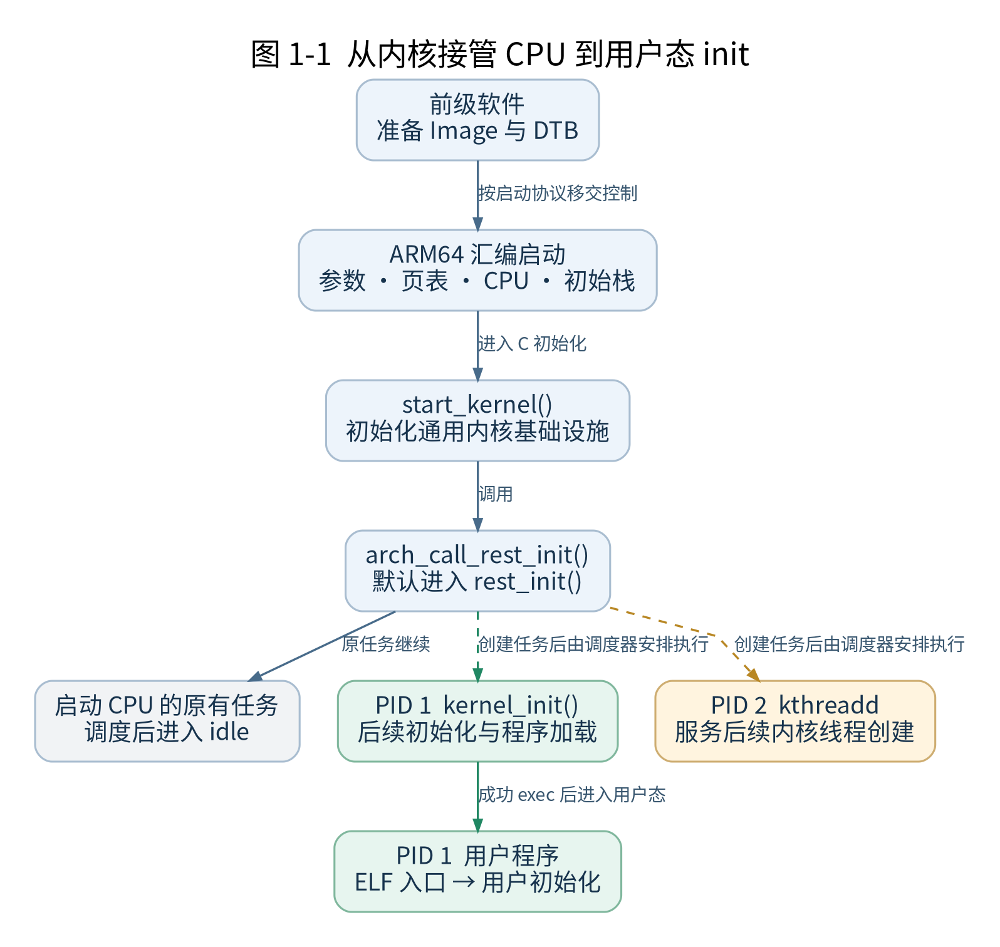
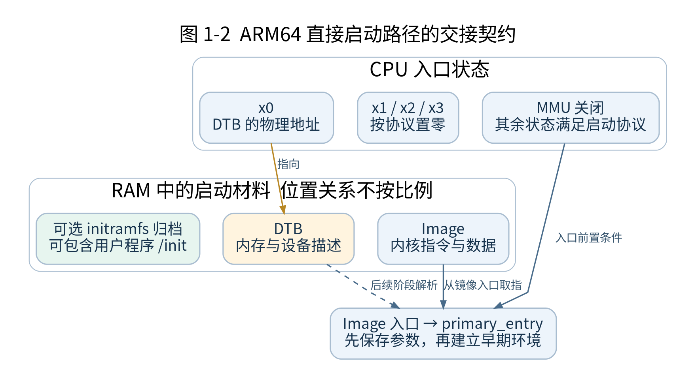
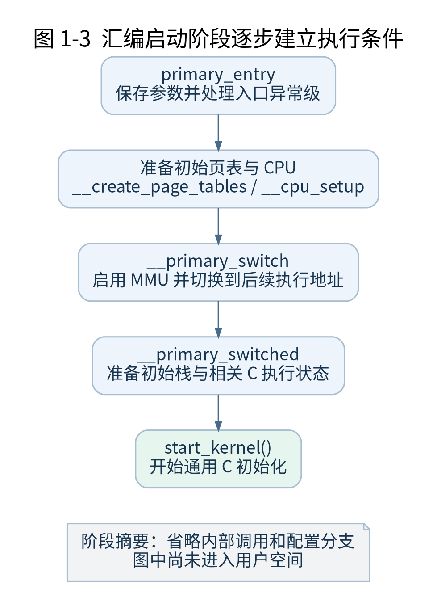
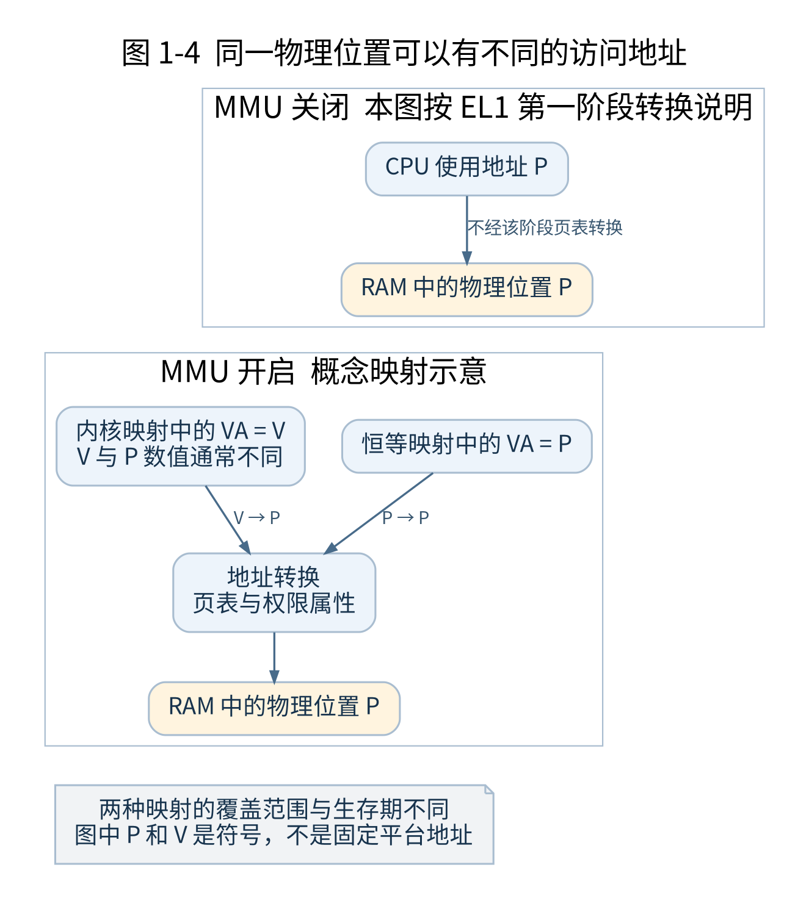
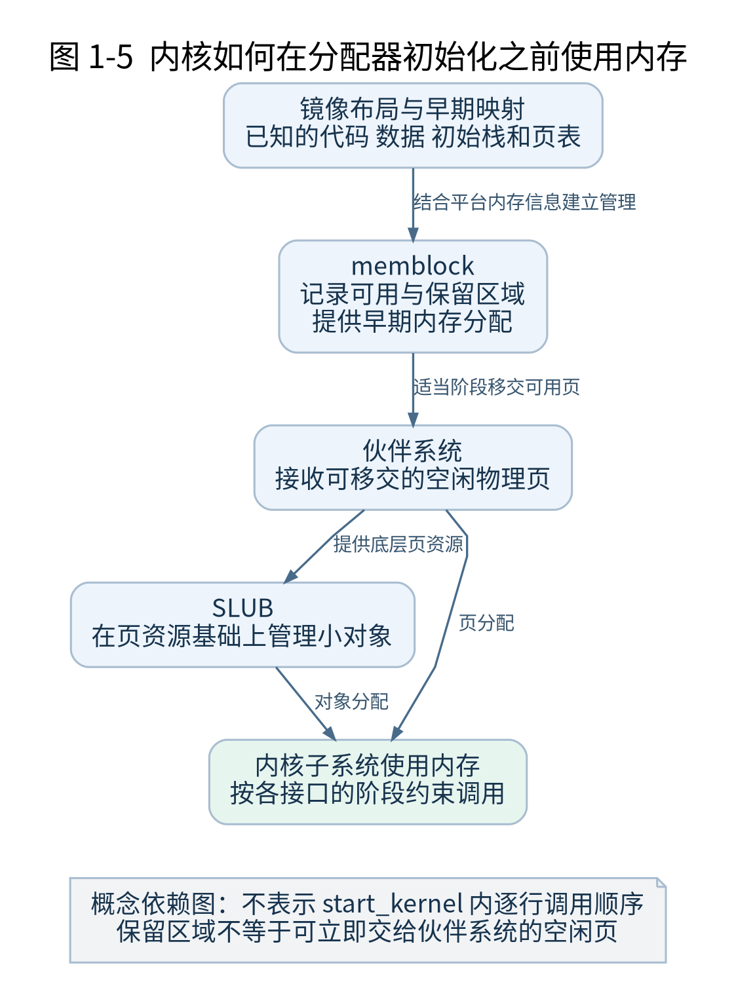
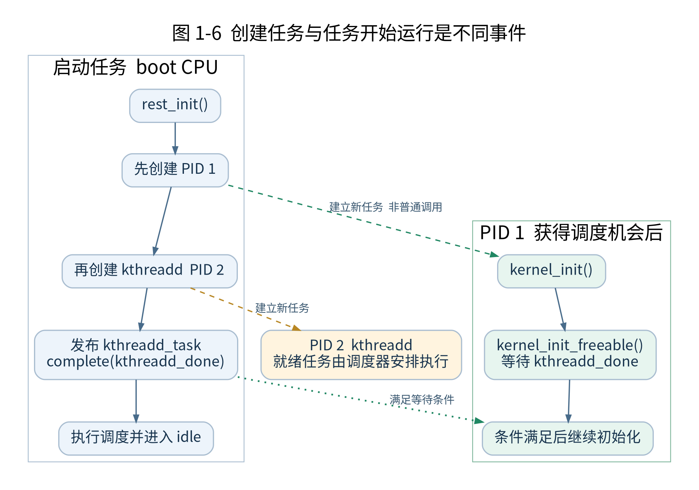
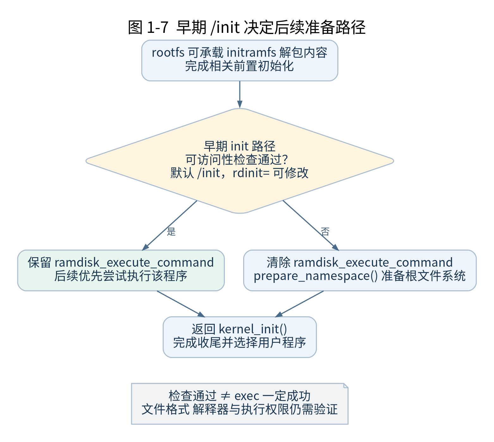
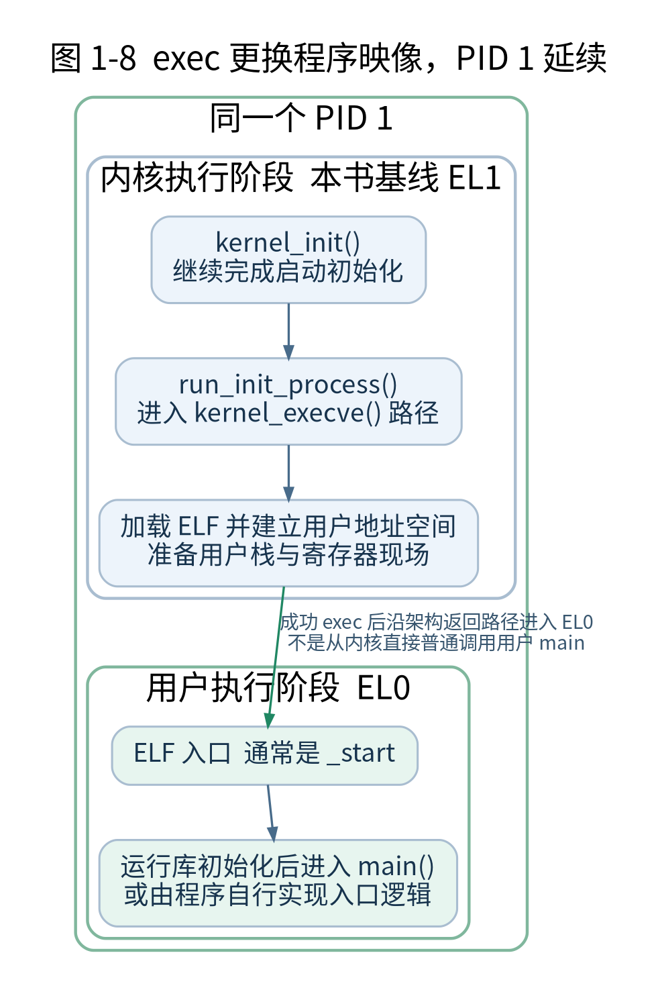

# 第 1 章 Linux 启动全景

[返回全书目录](../README.md)

打开 init/main.c，找到 `start_kernel()`，你会看到一串初始化函数。逐个查找函数的定义并不困难，困难在于理解它们为什么按这个顺序出现，以及它们执行时系统已经具备哪些能力。

例如，建立调度器之前，CPU 上当然已经有指令在运行；初始化页分配器之前，内核也已经使用了内存；用户空间还没有出现时，PID 1 已经可能存在。要理解这些现象，需要先建立启动过程的整体模型。本章先说明各阶段之间的关系，为后续逐行阅读提供定位依据。

本章完成后，你应能区分内核入口与 C 入口，说明启动早期如何使用内存，指出 PID 1 的创建与用户程序执行之间的边界，并在源码中找到对应位置。

### 1.1 从 CPU 的视角理解启动

CPU 执行的是内存中的指令。它按照体系结构规则取指、译码、读写寄存器和访问内存。Linux 能够管理进程、分配内存和处理文件，是因为相应代码及数据结构已经建立起来，并在运行中遵守一组约定。

因此，分析启动首先要问：当前执行地址在哪里？这个地址如何解释？当前栈在哪里？发生异常时跳向哪里？这些问题即使在没有进程列表、文件系统和终端的阶段，也必须有答案。

普通应用程序的 main() 被调用之前，程序加载器、用户空间运行库和内核已经完成许多准备。内核不能假定这些服务在它自己的入口处存在。它要接管的是一个满足启动协议、但尚未建立完整 Linux 运行环境的 CPU。

这里的“从零”也有明确边界。我们从内核接管 CPU 开始追踪。内存初始化、镜像搬运等工作通常已经由前级软件完成。在真实设备上，前级软件可能包含多个固件阶段；在 QEMU 实验中，模拟器及其启动机制承担一部分准备工作。



**图 1-1　启动阶段与任务分支**

沿主线向下阅读到 `rest_init()`，再看三个任务分支。虚线表示创建任务，子任务要获得调度机会才会运行。绿色分支上的 PID 1 从内核阶段延续到用户阶段。图中不表示三个任务在单核上同时执行。

### 1.2 前级软件交给内核什么

以使用设备树的常见 ARM64 启动路径为例，前级软件需要把内核镜像放在满足启动协议要求的位置，准备设备树，并让 CPU 以规定状态进入内核。设备树描述内存和设备等硬件信息，它不是可以直接调用的设备驱动。[1]

在该协议下，x0 携带 DTB 的物理地址，x1 至 x3 按协议置零。内核入口处 MMU 应关闭，同时对 Cache、一致性和异常级等状态有进一步要求。完整要求将在第八章逐项说明；此处先记住，入口状态来自明确契约，不能由内核任意猜测。[1]

“物理地址”在这里非常重要。入口处尚未启用内核准备的地址转换，设备树指针不能直接按后面高地址空间中的普通指针来理解。head.S 会先保存启动信息，后续再由适当阶段解析它。

假设前级软件传入了一个错误 DTB 地址。故障可能发生在串口控制台建立之前，表现为没有任何启动输出。因此，“没有日志”不能直接证明 CPU 没有进入内核，必须结合入口断点和寄存器状态判断。



**图 1-2　CPU 状态与 RAM 中的启动材料**

注意 `x0` 指向 DTB，而 CPU 从 Image 的入口取指。DTB 是硬件描述数据，Image 是内核镜像，initramfs 是可选文件归档；三者承担不同职责。图中各材料的放置顺序不表示实际地址布局。

### 1.3 为什么内核从汇编开始

Linux v5.10 的 ARM64 启动入口位于 arch/arm64/kernel/head.S。Image 头包含入口分支及镜像元数据；在本书选用的直接启动路径中，执行流进入 `primary_entry`。[2]

请先看一条指令：

```asm
bl preserve_boot_args

```

bl 表示带链接的分支，可用于调用子程序。它保存返回位置，再跳往目标；`preserve_boot_args` 是目标符号。现在无需记住全部调用约定，只需知道 CPU 正在执行真实指令，而且这条调用发生在 `start_kernel()` 之前。

`primary_entry` 的工作包括保存启动参数、处理进入内核时的异常级、准备初始页表、进行 CPU 设置，再转向启用地址转换及后续切换的路径。沿这段源码继续追踪，会经过 `__primary_switch`，并最终到达 `__primary_switched` 中跳入 `start_kernel` 的位置。[2]

这些准备之所以放在汇编里，是因为代码需要直接控制系统寄存器、异常返回和地址转换。此时栈和内存布局也正在建立，不能先假定普通 C 函数所需环境已经完备。

阅读这一阶段时，要记录每条关键指令执行后的变化。例如，保存 DTB 地址改变了哪个寄存器，写入页表基址改变了哪项 CPU 状态，切换地址空间之后下一条指令从哪里取到。这样才能把汇编代码理解为状态变化过程。



**图 1-3　汇编先建立 C 初始化所需的条件**

顺着阶段框阅读，并为每一步补上一个状态问题：参数保存了吗？页表准备好了吗？地址转换启用了吗？栈可以使用了吗？这里展示的是阶段关系，内部调用与配置分支将在后续章节展开。

### 1.4 从物理地址走向虚拟地址

假设某条指令要读取地址 A。MMU 关闭时，CPU 不会使用内核设置的 EL1 页表来把 A 转换为另一个地址；MMU 启用后，访问能否成功，就取决于转换配置、页表内容、权限和内存属性。

如果只打开 MMU，却没有让接下来的取指地址得到正确映射，CPU 就可能马上发生异常。因此，早期页表必须覆盖启用 MMU 时的必要访问。启动代码还要完成从过渡执行环境到内核正常虚拟地址环境的衔接。

后文将重点区分恒等映射与内核映射。恒等映射让相关虚拟地址与物理地址具有相同数值，便于完成特定过渡；内核映射则让内核能够在预定虚拟地址布局中执行。它们的作用、覆盖范围和生存期并不相同。

此时暂时不背诵某个固定高地址。地址取决于配置、布局及可能的随机化。先建立“镜像放在哪里”和“代码运行时使用什么地址”这两个问题，再在页表章节推导具体数值。



**图 1-4　恒等映射与内核虚拟地址映射**

先看左侧不经过 EL1 第一阶段页表转换的访问，再看右侧启用转换后的映射。右侧两个访问地址可映射到同一物理位置；恒等映射只对相关范围成立，不表示所有内存都恒等映射。若存在更高异常级设置的第二阶段转换，需要另行分析。

### 1.5 start_kernel 依赖哪些已经成立的条件

`start_kernel()` 位于 init/main.c，是通用内核初始化的重要入口。到达这里时，ARM64 汇编启动代码已经完成进入这一 C 执行阶段所需的关键准备，包括早期地址转换、初始栈和相关状态。[2][3]

但“能够执行 C”与“能够使用全部内核服务”相隔很远。普通局部变量可以依赖栈保存，而动态分配、调度、完整控制台和文件访问，还需要各自子系统进入可用状态。

`start_kernel()` 按依赖关系推进初始化。以启动理解所需的粒度来看，它处理早期核心状态、架构设置、内存管理、调度器、中断和时间等内容，并继续走向后续启动阶段。具体函数交错及先后顺序将在第十四章按 v5.10 源码展开。[3]

例如，在正式页分配器准备好之前，内核仍要为一些初始化对象获得内存。早期内存管理机制承担这项工作。后续再把合适的物理内存交给正式分配器管理。理解“同一资源在不同阶段由不同机制管理”，就能解释很多看似循环依赖的问题。

初始化顺序也是阅读代码的重要线索。每看到一个函数，可以写下它运行前需要什么、运行后新增什么能力。若不知道某次初始化为什么放在这里，先找它依赖的对象与后续使用者，通常比单独解释函数名更有效。



**图 1-5　启动过程中的内存管理接棒**

先有已经放入内存的镜像及启动资源，再逐步建立早期和正式分配机制。不要把图中的箭头理解成所有分配器一次性按严格线性顺序完成初始化；这里解释的是资源依赖与移交关系。

### 1.6 正在执行代码的任务是谁

在 PID 1 创建之前，启动 CPU 已经运行着内核代码。随着早期执行环境建立，内核使用静态准备的初始任务及其栈来表示这段执行上下文。相关核心对象是 `init_task`，通常从 PID 0 的角度理解它。[4]

`init_task` 与函数 `kernel_init` 不是同一个概念。前者是任务数据结构的实例，后者是随后新建任务开始运行时执行的函数。它们的名称都带 init，容易在阅读时混淆。

任务结构记录调度所需的身份和状态，内核栈用于保存这条执行流上的调用现场。CPU 在任务之间切换时，需要保存和恢复相应上下文。只是从函数 A 调用函数 B，并不会因此产生一个新任务。

启动 CPU 的原有任务继续推进，最终走向 idle 路径。多核系统中，其他 CPU 也有自己的 idle 任务。因此，“PID 0”不能简单想成一个在所有 CPU 之间独占运行的普通用户进程。

### 1.7 rest_init 如何让 PID 1 出现

在 v5.10 中，`start_kernel()` 末尾通过 `arch_call_rest_init()` 进入后续路径；其默认实现调用 `rest_init()`。这里必须保留架构钩子这一层，避免把所有实现都误写成 `start_kernel` 直接调用 `rest_init`。[3]

`rest_init()` 使用 `kernel_thread()` 创建以 `kernel_init` 为起始函数的任务，并随后创建 kthreadd。源码注释明确解释了顺序：先创建 init，使其获得 PID 1；同时还要通过同步机制保证它在依赖 kthreadd 的阶段不会过早继续。[3]

在本书正常启动路径中，kthreadd 获得 PID 2，负责后续内核线程创建请求等工作。`rest_init()` 建立 `kthreadd_task`，完成相关同步，并让启动 CPU 的原有任务执行调度及 idle 路径。

创建 PID 1，只说明新任务已经建立。它是否马上占用 CPU、何时从等待中继续，是调度与同步共同决定的。不能把 `kernel_thread`(`kernel_init`, ...) 理解成当前任务普通调用 `kernel_init()`。

等 PID 1 真正被调度运行时，它开始执行的是内核函数 `kernel_init`。此时还没有因为“PID 等于 1”就自动进入用户空间。后续设备初始化、根文件系统准备和程序加载，仍然需要它继续完成。



**图 1-6　PID 1 创建顺序与就绪条件**

左侧从上到下表示启动任务的执行顺序；右侧表示创建出的任务。PID 1 即使提前获得调度，也要等待 `kthreadd_done` 条件满足才能越过该等待点。`complete()` 不等于直接调用或立即调度 PID 1。

### 1.8 kernel_init 如何准备用户空间

`kernel_init()` 首先调用 `kernel_init_freeable()`。后者等待 kthreadd 的就绪条件，继续进行多核准备、基础设施及 initcall 等初始化，随后检查早期用户空间程序等条件。[3]

initcall 是启动阶段组织初始化函数的一套机制。驱动和其他子系统可以通过相应宏把函数登记到初始化序列中。代码被编译进镜像，与初始化函数已经被执行，是两件不同的事。

`kernel_init_freeable()` 返回后，`kernel_init()` 还要等待相关异步初始化完成，释放可回收的初始化内存，并完成内存保护等收尾。内核不能仅因为某个初始化函数返回，就立即回收仍可能被异步执行代码引用的初始化区域。[3]

然后才是选择并执行用户程序。到这里，PID 1 已经存在了一段时间，执行了许多内核代码。“第一个用户程序”并不是由 Bootloader 直接跳转进去的，也不是 `start_kernel` 最后普通调用的一个 C 函数。

### 1.9 initramfs 中的 init 与真实根上的 init

内核需要先能访问程序文件，才能加载它。早期 rootfs 可以承载从 initramfs 归档解包出来的文件。这里的 /init 是路径名，程序可以由我们编写，也可以由现有用户空间工具提供。

在 v5.10 中，`ramdisk_execute_command` 默认指向 /init，可由 rdinit= 修改。`kernel_init_freeable()` 检查相应路径的可访问性；若检查失败，它会清除这一命令并进入 `prepare_namespace()` 等根文件系统准备路径。[3]

若早期 /init 可用，常见做法是让它在用户空间加载所需模块、发现设备、准备真实根并进行切换。另一种路径是让内核完成真实根的准备，再尝试运行其上的 init。

这里不能把“检查通过”写成“程序保证可以执行”。文件存在或可以访问，并不代表格式正确，也不代表动态解释器及依赖可用。最终执行仍可能失败。此时需要按实际程序加载错误分析，而不能仅检查文件名。



**图 1-7　早期 init 可访问性检查造成的分支**

在 `kernel_init_freeable()` 中先判断是否保留早期用户程序路径。两个分支都会返回 `kernel_init()`，后者再进行收尾与程序执行；“检查通过”并没有跳过真正的 exec 加载验证。

### 1.10 PID 1 如何换上用户程序

`kernel_init()` 会优先尝试仍然有效的 `ramdisk_execute_command`，再处理 init= 指定的 `execute_command`，随后考虑 CONFIG_DEFAULT_INIT，以及 /sbin/init、/etc/init、/bin/init、/bin/sh 等候选路径。各分支的失败处理不同，例如显式 init= 指定的程序执行失败会触发 panic。[3]

这说明“Linux 总是先执行 /sbin/init”并不准确。initramfs、启动参数及编译配置共同决定本次实际路径。排查启动问题时，先确认走到哪个分支，再研究为什么失败。

`run_init_process()` 进入内核执行用户程序的路径。对于本书后面使用的 ELF 程序，加载过程需要识别文件、建立相应用户地址空间、准备栈和寄存器现场，最终使 PID 1 能够开始执行用户代码。[3][5]

exec 的关键是保留当前任务身份并更换程序映像。PID 1 不需要先 fork 出另一个进程，再把 PID 转交给它。用户程序看到的 PID 1，延续自前面运行 `kernel_init` 的那一任务。

本书以运行于 EL1 的常见内核配置为基础说明用户态切换。进入 EL0 时，CPU 从准备好的用户入口和栈开始执行。对普通 ELF 程序而言，该入口通常是 _start；运行库再按约定进入 main。静态链接只减少动态链接依赖，不会省去内核对程序的加载。



**图 1-8　PID 1 的身份不变而程序映像发生变化**

绿色外框代表同一个 PID 1。exec 为它安装用户程序及对应用户执行环境；进入 EL0 是 CPU 执行状态的变化，不会另行产生一个 PID。对于带动态解释器的 ELF，最先执行的用户指令还可能位于解释器中；本图重点对应后续实验使用的静态链接程序。

### 启动阶段对照

| 阶段 | 执行上下文 | 主要变化 |
| --- | --- | --- |
| 汇编入口 | 启动 CPU 的早期执行流 | 保存参数并建立早期环境 |
| `start_kernel()` | 启动任务 | 初始化通用内核基础设施 |
| `rest_init()` | 启动任务 | 创建 PID 1 与 kthreadd |
| `kernel_init()` | PID 1 的内核执行阶段 | 完成初始化并准备执行用户程序 |
| 用户程序入口 | PID 1 的用户执行阶段 | 执行用户程序及其初始化逻辑 |

表中包含任务创建与调度关系，不能按单一任务的普通调用栈理解。

### 1.11 用四条观察线阅读后续章节

第一条是执行位置。记录当前在 Image 入口、汇编启动函数、`start_kernel`、PID 1 的内核函数，还是用户程序中。这样能避免把源码文件顺序当成实际执行顺序。

第二条是地址状态。记录 MMU 是否启用，当前指针属于物理地址还是虚拟地址，访问依赖哪组映射。早期地址错误经常发生在不同地址含义被混用的地方。

第三条是任务身份。记录正在启动任务、PID 1、kthreadd 还是其他任务中。函数断点命中后，最好同时确认 current 所代表的任务。仅有函数名并不足以说明是哪条执行流到达此处。

第四条是可用能力。记录当前是否能够动态分配、睡眠、接受中断或访问文件。代码的合法性与阶段有关；某个接口平时可以使用，不代表在任意启动时刻都可以使用。

后续章节会反复更新这四条观察线。理解启动过程的目标，是能在任何一个关键断点回答这些问题，而不只是复述一串函数名称。

### 1.12 第一次源码阅读练习

本节只要求准备上游 v5.10 源码，不要求编译。若暂时没有源码，可以先通过本章末尾列出的官方仓库链接阅读。完整下载、环境版本记录和构建步骤安排在第二章。

在源码根目录执行以下定位命令。rg 是文本检索工具，搜索结果可能同时包含声明、定义、注释和调用，因此仍要打开上下文确认。

```sh
rg -n 'primary_entry|__primary_switch|__primary_switched' arch/arm64/kernel/head.S
rg -n 'start_kernel|arch_call_rest_init|rest_init' init/main.c
rg -n 'kernel_init_freeable|run_init_process' init/main.c
rg -n 'ramdisk_execute_command|execute_command' init/main.c

```

先在 `primary_entry` 附近找到保存启动参数和准备页表的调用。接着在 `__primary_switched` 附近找到 `start_kernel`。不要尝试现在就理解所有寄存器，先确认汇编启动阶段确实存在于 C 初始化之前。

再打开 `rest_init`，找到创建 `kernel_init` 和 kthreadd 的语句。阅读它们前后的注释，回答为什么创建顺序与同步缺一不可。最后找到 `kernel_init` 中选择用户程序的分支，并检查显式 init= 失败时是否会继续尝试所有默认路径。

完成练习的证据，是一页你自己整理的启动记录：每个关键符号写出文件路径、作用、所属任务，以及它与下一个节点之间究竟是调用、任务创建、调度还是 exec。暂时未知的项目可以标记为待验证，后续实验再补齐。

### 1.13 检查点与参考解答

**问题一：CPU 已进入 Linux，但没有串口输出，是否一定没有执行到 `start_kernel`？**

不能这样判断。控制台及输出路径需要初始化；错误的参数、早期映射或控制台配置均可能影响观察。应结合入口断点、`start_kernel` 断点和 CPU 状态继续定位。

**问题二：创建 PID 1 的那条语句执行完，是否表示用户态 /init 已经开始？**

没有。新任务还要获得运行机会，执行 `kernel_init` 的内核阶段，完成后续初始化与程序加载，才可能进入用户空间。

**问题三：为什么 `init_task` 不能直接等同于用户态 init？**

`init_task` 是静态准备的初始任务对象。用户态 init 通常运行于后来创建的 PID 1 中。对象、任务身份和被执行程序需要分开理解。

**问题四：存在 /init 文件，为什么仍可能无法启动？**

文件可能不可执行、格式不支持、架构错误，或者缺失 ELF 解释器等。路径检查与实际 exec 成功之间还有加载阶段，需根据具体错误继续分析。

**问题五：如果成功 exec 了用户程序，PID 1 会不会变成另一个 PID？**

exec 更换程序映像，保留当前任务的 PID。前后程序不同，任务身份延续。

**问题六：为什么 MMU 开启之前就需要准备页表？**

开启地址转换后，接下来的取指和数据访问立即受到转换规则约束。若所需映射尚未准备好，CPU 就无法可靠地继续执行。

到这里，我们已经知道后续阅读要追踪哪些边界。下一章将把这些位置变成可复现的实验：固定源码与配置，构建 Image 和 vmlinux，准备启动材料，并使用 QEMU 与 GDB 观察 CPU 如何抵达关键入口。


### 1.15 本章配图索引

| 图号 | 概念 | 阅读位置 |
| --- | --- | --- |
| 1-1 | 启动全景与任务分支 | 第 1 章 |
| 1-2 | 内核接管时的寄存器与内存 | 第 1 章 |
| 1-3 | 汇编到 C 的状态变化 | 第 1 章 |
| 1-4 | 恒等映射与内核映射 | 第 1 章 |
| 1-5 | 启动阶段的内存来源 | 第 1 章 |
| 1-6 | PID 1 与 kthreadd 的同步 | 第 1 章 |
| 1-7 | 早期 init 的根文件系统分支 | 第 1 章 |
| 1-8 | PID 1 从内核执行阶段进入用户态 | 第 1 章 |


### 1.14 本章源码依据

[1] Linux v5.10 Documentation/arm64/booting.rst，重点阅读 Setup the device tree、Call the kernel image 及入口状态要求。

<https://github.com/torvalds/linux/blob/v5.10/Documentation/arm64/booting.rst>

[2] Linux v5.10 arch/arm64/kernel/head.S，重点阅读 Image 头、`primary_entry`、`__primary_switch` 与 `__primary_switched`。

<https://github.com/torvalds/linux/blob/v5.10/arch/arm64/kernel/head.S>

[3] Linux v5.10 init/main.c，重点阅读 `start_kernel`、`arch_call_rest_init`、`rest_init`、`kernel_init_freeable`、`kernel_init` 与 `run_init_process`。

<https://github.com/torvalds/linux/blob/v5.10/init/main.c>

[4] Linux v5.10 init/`init_task`.c，阅读 `init_task` 的静态定义及其关联对象。

<https://github.com/torvalds/linux/blob/v5.10/init/init_task.c>

[5] Linux v5.10 fs/exec.c 与 fs/`binfmt_elf`.c，分别对应执行程序的通用路径及 ELF 加载。细节将在第二十九、三十章展开。

<https://github.com/torvalds/linux/blob/v5.10/fs/exec.c>

<https://github.com/torvalds/linux/blob/v5.10/fs/binfmt_elf.c>
