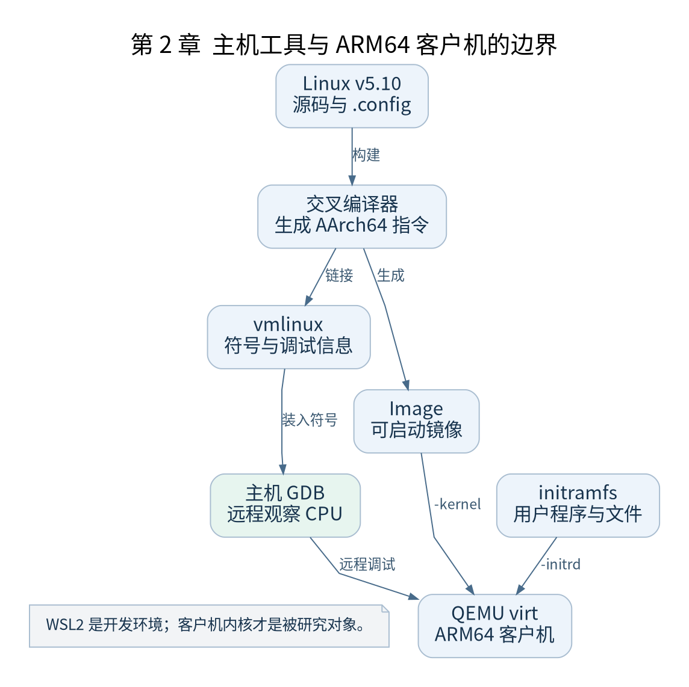

# 第 2 章 搭建能够重复验证的实验环境

[返回全书目录](../README.md)

本章把第一章的启动模型变成可以操作的实验。完成标志不是“编译没有报错”，而是能够用同一份源码、配置、启动参数和用户空间材料重复到达 PID 1。先记录版本，再构建，再启动，最后设置断点；某一步失败时只处理该层问题。



**图 2-1　主机工具与 ARM64 客户机的边界**

读图提示：WSL2 是开发环境；客户机内核才是被研究对象。 图的箭头表达标注的关系；未标明为调用的箭头，不应当作普通函数调用栈。

### 2.1 固定实验边界

主机采用 x86_64 Ubuntu 22.04，Windows 用户在 WSL2 的 Linux 文件系统中工作，例如 `~/arm64-book`。把大型构建目录放在 `/mnt/c` 会增加跨文件系统开销，也更容易遇到权限和大小写问题。WSL2 运行的是主机开发环境，QEMU 里面运行的 ARM64 Linux 才是本书研究对象。

建议以 Ubuntu 22.04 提供的 GCC 11 交叉工具链为起点。QEMU 和 GDB 的实际包版本必须记录；本书固定内核标签，但没有把发行版软件包声称为永远不变的二进制环境。附带的 `record-env.sh` 会记录可执行文件版本与内核配置哈希。

```sh
sudo apt-get update
sudo apt-get install git make gcc-aarch64-linux-gnu binutils-aarch64-linux-gnu \
  qemu-system-arm gdb-multiarch flex bison libssl-dev libelf-dev bc \
  python3 cpio gzip ripgrep
```

这些是读者主机上的安装命令。交叉编译器生成 AArch64 指令，QEMU 执行这些指令；二者不能相互替代。`gdb-multiarch` 通过远程调试协议控制 QEMU，通常不需要在客户机内安装 GDB 服务。

### 2.2 认识四种输入输出

| 文件 | 用途 | 能否直接作为本书 QEMU 的内核参数 |
| --- | --- | --- |
| `vmlinux` | 带符号的 ELF，供反汇编和 GDB 使用 | 本书不这样使用 |
| `arch/arm64/boot/Image` | ARM64 启动镜像 | 是，传给 `-kernel` |
| `.config` | 本次构建配置 | 否，决定编译结果 |
| `initramfs.cpio.gz` | 早期用户空间文件归档 | 传给 `-initrd` |

先运行 `labs/fetch-kernel.sh` 获取 `v5.10`，再运行 `labs/build-kernel.sh`。脚本使用独立 `out` 目录，关闭地址随机化，启用调试信息及 PL011 控制台等实验选项。它还会执行 `olddefconfig`，让 Kconfig 重新解算依赖。脚本请求某选项并不保证它最终生效，因此要检查生成的 `.config`。

### 2.3 为什么现在就准备 init

没有可运行的用户程序，内核可能完成大量初始化后以找不到 init 结束。为了观察完整路径，本章使用第三十一章给出的最小静态程序。你现在可以把它当作启动材料，后面再逐行研究。运行 `labs/build-initramfs.sh` 生成归档，然后运行 `labs/run-qemu.sh`。

成功时的预期证据是：串口显示 Linux 启动日志，随后出现最小程序输出的 `pid=1`。它会提供简单命令循环；这是本书自带的用户程序，不是 BusyBox Shell。退出 QEMU 的常见按键为 `Ctrl+A` 后按 `X`，具体受终端与 QEMU 选项影响。

### 2.4 第一个断点

```sh
# 终端一：暂停 CPU 并开放本地 GDB 端口
bash labs/run-qemu.sh --debug
# 终端二
gdb-multiarch work/out/vmlinux
```

在 GDB 中依次执行 `target remote :1234`、`hbreak start_kernel`、`continue`。关闭 KASLR 并确认符号文件与 Image 来自同一次构建后，该断点用于验证通用 C 初始化入口。不要把此处断点成功当作汇编入口断点也必然成功：启用 MMU 之前的执行地址需要额外计算，见第十三章。

### 2.5 验证与排错

保存 `.config`、构建日志、环境记录和 QEMU 命令行。无输出先检查串口选项、Image 路径和入口断点；出现 `No working init found` 再检查归档、`rdinit=/init`、执行权限和架构。若编译器过新导致告警升级或汇编不兼容，先回到记录过的工具链，不要随意修改内核源码绕过诊断。

本章检查点：说明 `Image` 与 `vmlinux` 为什么必须来自同一次构建；把“启动到 C”“找到用户程序”“成功进入用户态”分别列为不同验收条件。这样下一次失败时才能知道是哪一层退化。

### 本章源码阅读入口

- [`Makefile`](https://github.com/torvalds/linux/blob/v5.10/Makefile)
- [`Documentation/arm64/booting.rst`](https://github.com/torvalds/linux/blob/v5.10/Documentation/arm64/booting.rst)

从书包根目录执行以下定位命令，再打开定义或调用点上下文。搜索命中只提供位置，不能替代对配置分支与对象状态的判断。

```sh
rg -n 'VERSION|PATCHLEVEL' work/linux/Makefile work/linux/Documentation/arm64/booting.rst
```

