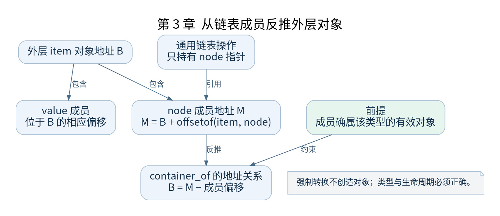

# 第 3 章 阅读内核必需的 C 语言

[返回全书目录](../README.md)

内核大量使用 C，但它不是带完整标准库的普通应用。阅读时既要理解语言表达式，也要识别编译器扩展、生命周期和并发约束。本章围绕后续会遇到的代码形态建立最小工具箱。



**图 3-1　从链表成员反推外层对象**

读图提示：强制转换不创造对象；类型与生命周期必须正确。 图的箭头表达标注的关系；未标明为调用的箭头，不应当作普通函数调用栈。

### 3.1 对象 地址与指针

`struct task_struct *p` 保存任务对象的地址；`p->pid` 访问该地址对应结构中的成员。指针类型影响地址计算：`p + 1` 增加的是一个结构的大小，不是一个字节。地址数值相同也不必然代表可以按任意类型访问，仍受到对象有效性、对齐和映射权限限制。

对启动代码，还要再问指针所处的地址空间。一个 `void *` 并不会在类型里标出它是早期物理地址还是正常内核虚拟地址。转换由明确函数和体系结构规则完成，强制类型转换只改变编译器如何解释表达式，不会自动修改页表。

### 3.2 嵌入式结构与 container_of

内核常把链表节点嵌入实际对象。链表代码只知道 `struct list_head` 的地址，业务代码再由该成员地址反推出外层对象。原理是“成员地址减去成员在结构中的偏移”。

```c
/* 教学示意，展示地址关系，不代替内核宏实现 */
struct item { int value; struct list_head node; };
/* item_address = node_address - offsetof(struct item, node) */
```

这种设计允许同一个对象拥有多个链表成员，分别参与不同关系。但若传入的成员并不属于指定外层结构，计算出的指针就没有有效对象依据。读 `container_of()` 时必须同时确认指针来源、外层类型和成员名称。

### 3.3 函数指针与回调

函数指针把“何时调用”与“调用谁”分开。驱动注册中断处理函数之后，真正执行它的往往是中断分发路径；把地址写进结构，并没有当场执行函数。阅读 `irqaction`、文件操作表和 `initcall_t` 时，都可以使用这个模型。

沿回调查源码时先找赋值，再找读取和调用。只搜索函数名会漏掉通过函数指针发生的调用。调试器断点可以验证回调确实执行，但执行前的注册关系仍需要静态分析说明。

### 3.4 宏与 GNU C 扩展

`typeof`、语句表达式、可变参数宏和属性声明会把短小的代码展开成较复杂形式。第一次阅读应分三层：宏在调用位置提供什么接口，展开后主要做什么，哪些细节由配置或编译器处理。使用预处理结果辅助理解时，必须复用构建系统的实际编译选项。

`__init` 将适合回收的初始化函数放到特定节。它不表示“第一次调用之后自动删除函数”。初始化区域是在明确的启动收尾阶段统一释放；持久代码若继续引用其中对象，会产生生命周期错误。

### 3.5 位操作 对齐与并发

页表描述符和系统寄存器把多个字段装入一个整数。读表达式时先标出位域宽度与位偏移，再判断掩码是保留位还是清除位。用无符号值表达位掩码，避免把移位中的符号扩展混进推导。

`volatile` 主要约束相关访问的编译行为，不能代替原子操作、锁或体系结构内存屏障。编译器屏障影响编译重排，CPU 屏障涉及处理器观察到的内存顺序；二者解决的问题不同。即使本书从单核开始，中断上下文仍可能引入并发访问。

### 3.6 阅读练习

在 `include/linux/init.h` 中定位 `__init` 和 initcall 相关定义，在 `init/main.c` 中找一个使用点，再到链接脚本中确认节如何收集。为每个符号写出“类型、存放位置、何时使用、何时失效”。

检查点：注册一个函数与执行一个函数是否相同？强制转换能否让物理地址自动变成虚拟地址？为什么只用 `volatile` 不能保证链表更新在另一 CPU 上按预期顺序可见？能分别说明这三个问题，才算具备继续阅读的基础。

### 本章源码阅读入口

- [`include/linux/init.h`](https://github.com/torvalds/linux/blob/v5.10/include/linux/init.h)
- [`init/main.c`](https://github.com/torvalds/linux/blob/v5.10/init/main.c)

从书包根目录执行以下定位命令，再打开定义或调用点上下文。搜索命中只提供位置，不能替代对配置分支与对象状态的判断。

```sh
rg -n '__init|initcall_t' work/linux/include/linux/init.h work/linux/init/main.c
```

