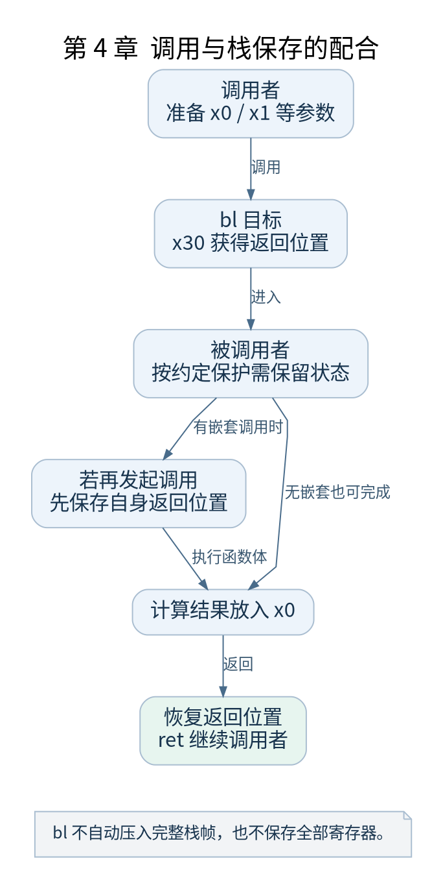

# 第 4 章 AArch64 汇编入门

[返回全书目录](../README.md)

本章的目标是读懂 `head.S` 和 `entry.S` 中的常见指令。先把寄存器当作保存有限位宽数值的存储位置，再研究这些数值在当前上下文中代表地址、参数还是控制字段。



**图 4-1　调用与栈保存的配合**

读图提示：bl 不自动压入完整栈帧，也不保存全部寄存器。 图的箭头表达标注的关系；未标明为调用的箭头，不应当作普通函数调用栈。

### 4.1 通用寄存器与零寄存器

`x0`～`x30` 是 64 位通用寄存器，`w0`～`w30` 表示对应寄存器的低 32 位访问视图。写入 W 寄存器会把对应 X 寄存器的高 32 位清零。某些指令编码中的寄存器编号 31 表示 SP，另一些表示零寄存器；要按指令语义区分。

`x30` 通常用作链接寄存器，`x29` 通常用作帧指针，但这些角色来自调用约定和代码约定。寄存器本身不会知道哪个值是返回地址。启动汇编还可能给寄存器安排跨多个函数保存 DTB 指针等专门用途。

### 4.2 调用和返回如何配合

```asm
/* 教学函数：返回两个整数参数之和 */
add_two:
    add x0, x0, x1
    ret
```

按常见 AArch64 调用约定，前几个整数或指针参数经 `x0`～`x7` 传入，返回值常在 `x0`。`bl` 写入返回地址再跳转，`ret` 默认按 `x30` 返回。若函数还要调用另一函数，它就必须按需要保存自己的返回位置，否则后一个 `bl` 会覆盖原返回地址。

`b` 是不保存链接的分支，`blr` 通过寄存器保存的地址发起带链接调用。内核中的尾调用与启动跳转经常使用 `b`，因此不能仅看某标签名像函数，就假定它一定通过普通调用返回。

### 4.3 加载 存储与寻址

`ldr/str` 操作单个寄存器，`ldp/stp` 操作一对寄存器。方括号表示内存寻址，前索引写回和后索引写回还会修改基址寄存器。读栈操作时要同时记录“访问了哪些字节”和“SP 最后变成多少”。

常见压栈序列为 `stp x29, x30, [sp, #-16]!`。它先把 SP 减少 16，再存放两个 64 位值。栈增长方向与地址数值变化有关，不代表内存硬件真的移动了数据。恢复操作需要与保存布局一致。

### 4.4 如何构造地址

`adr` 产生相对 PC 的地址，`adrp` 先定位相应的 4KB 地址页，再配合低位偏移。这里的 4KB 是该指令寻址编码的粒度，不应和所有内核页大小配置混为一谈。`ldr xN, =symbol` 是汇编伪指令，其最终实现要检查目标文件。

启动时同一符号有链接地址与实际加载位置两个角度。某些 PC 相对计算在 MMU 关闭时可以找到当前镜像内的数据，直接使用链接高地址则可能不成立。第七章与第十三章会把这个区别接到真实布局。

### 4.5 系统寄存器与异常返回

`mrs` 读系统寄存器，`msr` 写系统寄存器。写 `SCTLR_EL1` 会影响地址转换和其他控制状态；`eret` 按异常返回机制恢复状态与执行位置，和普通 `ret` 的作用不同。`isb` 使后续取指按要求观察前面的上下文变化，不能理解为“刷新所有内存”。

### 4.6 反汇编练习

用 `aarch64-linux-gnu-objdump -dr work/out/arch/arm64/kernel/head.o` 查看目标文件，再对照源码。记录一个 `bl` 的目标、一个 `adrp` 的重定位和一个带写回的存储操作。目标文件可能仍含重定位，最终地址需要再看 `vmlinux`。

检查点：`bl` 会自动保存全部寄存器吗？不会。调用约定要求谁保存哪些寄存器，调用者与被调用者分别履行约定。后续看到 `cpu_switch_to` 时，还要区分普通函数调用保存规则与任务切换保存规则。

### 本章源码阅读入口

- [`arch/arm64/kernel/head.S`](https://github.com/torvalds/linux/blob/v5.10/arch/arm64/kernel/head.S)
- [`arch/arm64/kernel/entry.S`](https://github.com/torvalds/linux/blob/v5.10/arch/arm64/kernel/entry.S)

从书包根目录执行以下定位命令，再打开定义或调用点上下文。搜索命中只提供位置，不能替代对配置分支与对象状态的判断。

```sh
rg -n 'preserve_boot_args|cpu_switch_to' work/linux/arch/arm64/kernel/head.S work/linux/arch/arm64/kernel/entry.S
```

