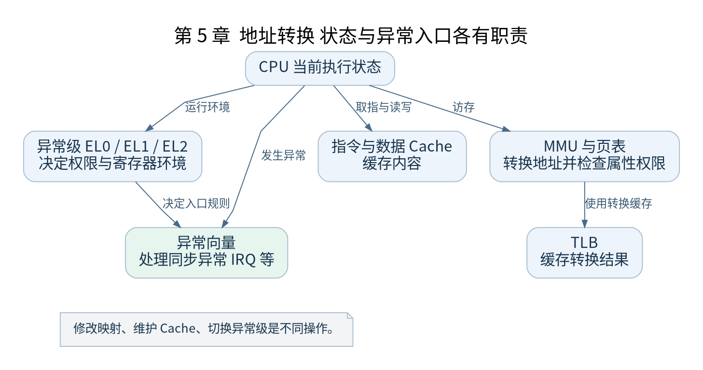

# 第 5 章 ARM64 系统架构基础

[返回全书目录](../README.md)

启动代码会频繁访问异常级、地址转换和中断控制状态。本章先建立这些概念之间的边界，避免把“进入内核”“关闭中断”和“开启 MMU”当成同一件事。



**图 5-1　地址转换 状态与异常入口各有职责**

读图提示：修改映射、维护 Cache、切换异常级是不同操作。 图的箭头表达标注的关系；未标明为调用的箭头，不应当作普通函数调用栈。

### 5.1 异常级表示执行权限和环境

在本书基线中，用户程序运行于 EL0，内核运行于 EL1。EL2 用于虚拟化相关控制，EL3 涉及安全监控环境。Linux 支持的实际执行模式还受到 VHE 等特性影响，所以 EL1 是本书选用的环境，而不是所有 ARM64 Linux 的唯一运行级别。

发生异常时，硬件按规则记录返回地址和原状态，并转到相应向量入口。软件还需要把通用寄存器保存到内存；硬件不会替内核自动构造完整 `pt_regs`。异常返回时再按保存的状态恢复执行。

### 5.2 几个必须认识的系统寄存器

| 寄存器 | 本书阅读重点 |
| --- | --- |
| `CurrentEL` | 判断当前异常级 |
| `VBAR_EL1` | EL1 异常向量表基址 |
| `ELR_EL1` 与 `SPSR_EL1` | 异常返回位置与保存的状态 |
| `TTBR0_EL1` 与 `TTBR1_EL1` | EL1 地址转换所用的两组基址 |
| `TCR_EL1` | 地址宽度、转换粒度等规则 |
| `MAIR_EL1` | 描述内存属性编码 |
| `SCTLR_EL1` | MMU 等执行控制 |

表中只列出本书关注的职责，不是寄存器完整定义。读每次写入时要结合该字段的体系结构语义，保留位也不能任意清零。

### 5.3 页表 TLB 与 Cache 各管什么

页表描述虚拟地址到物理地址的映射和访问属性。TLB 缓存转换结果，因此修改页表后，旧转换可能仍然存在，需要按规则完成屏障及失效操作。数据 Cache 和指令 Cache 缓存的是内容，和 TLB 缓存地址转换不是同一层机制。

例如，把一个虚拟页从物理页 P 改映射到 Q，仅仅写入新描述符并不充分。还需考虑处理器正在使用的旧转换及架构要求的更新顺序。反过来，清理数据 Cache 也不等于让 TLB 中的旧映射自动消失。

### 5.4 普通内存与设备内存

RAM 通常使用 Normal 类型映射，外设寄存器使用适当的 Device 属性。CPU 对不同属性的访问可以有不同的合并、重排和推测限制。把 UART 寄存器当作普通可缓存 RAM 映射，可能让访问行为偏离设备要求。

内核通过描述符中的属性索引和 `MAIR_EL1` 的对应编码表达这些属性。因此，单独读页表项的地址字段不足以证明映射正确，还要检查属性和权限。

### 5.5 中断屏蔽与多核

DAIF 涉及异常屏蔽状态，是否能收到 IRQ 还取决于中断控制器、设备和 CPU 接口等条件。开启 CPU 的 IRQ 接收不等于任何设备中断都已配置完成。多核情况下还要考虑中断目标 CPU、每 CPU 状态及共享数据同步。

### 5.6 验证练习

在 `__cpu_setup` 中定位 `TCR_EL1` 和 `MAIR_EL1` 的准备，在 `__enable_mmu` 中定位页表基址与控制寄存器的使用。先写出“控制转换规则”“指向表”“启用转换”三个动作，再按实际代码排序。

检查点：页表写错与 Cache 内容过旧可能表现相似，但证据不同。前者需要检查转换和权限，后者需要检查一致性维护与内容来源。下一篇开始把这些状态与编译出来的镜像联系起来。

### 本章源码阅读入口

- [`arch/arm64/mm/proc.S`](https://github.com/torvalds/linux/blob/v5.10/arch/arm64/mm/proc.S)
- [`arch/arm64/kernel/entry.S`](https://github.com/torvalds/linux/blob/v5.10/arch/arm64/kernel/entry.S)

从书包根目录执行以下定位命令，再打开定义或调用点上下文。搜索命中只提供位置，不能替代对配置分支与对象状态的判断。

```sh
rg -n '__cpu_setup|vectors' work/linux/arch/arm64/mm/proc.S work/linux/arch/arm64/kernel/entry.S
```

