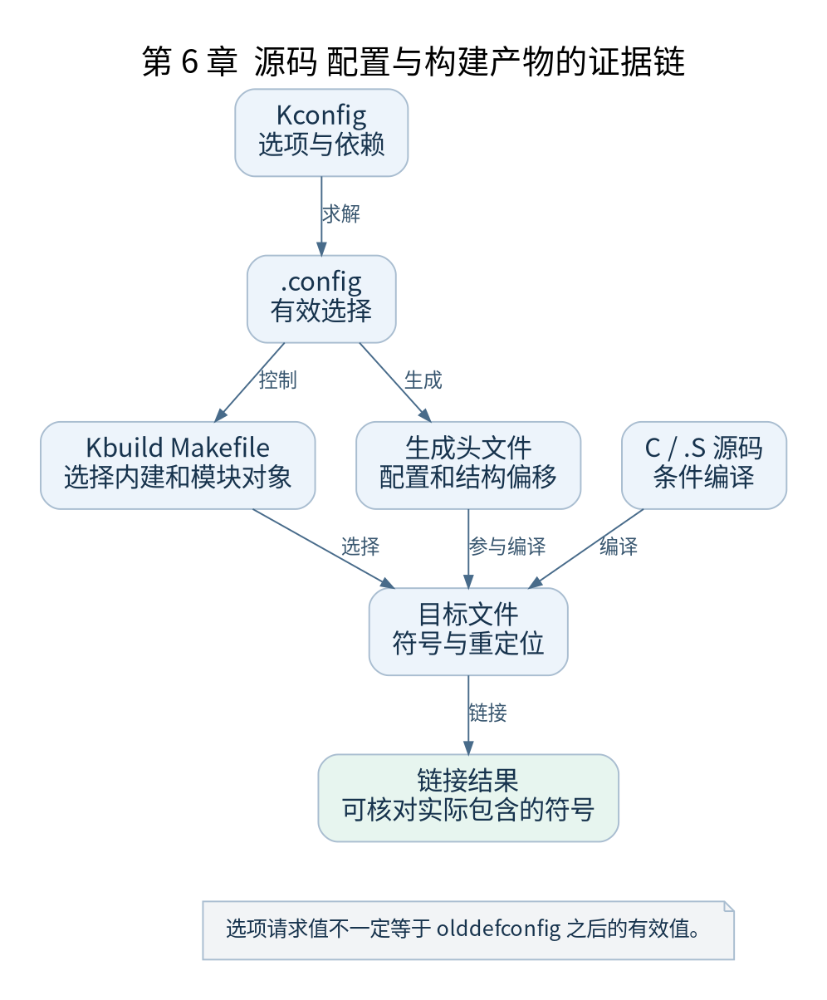

# 第 6 章 源码目录 Kconfig 与 Kbuild

[返回全书目录](../README.md)

内核中存在某个函数，不表示你的镜像包含它。要沿启动路径阅读真实代码，必须同时跟踪源码、配置和构建产物。本章解决“这段代码为什么被编译进来”的问题。



**图 6-1　源码 配置与构建产物的证据链**

读图提示：选项请求值不一定等于 olddefconfig 之后的有效值。 图的箭头表达标注的关系；未标明为调用的箭头，不应当作普通函数调用栈。

### 6.1 通用代码与架构代码如何分工

`init/` 组织启动主线，`mm/` 提供通用内存管理，`kernel/` 包含调度与任务等基础机制，`fs/` 提供文件系统和执行程序路径。`arch/arm64/` 补足寄存器、页表、异常入口和任务上下文等架构实现。

通用代码通过头文件、回调、弱符号或架构接口接入 ARM64。例如 `start_kernel()` 是通用初始化入口，而此前建立 CPU 状态的代码在 ARM64 汇编中。阅读时应记录从通用层进入架构层的边界，避免只在单个目录内搜索。

### 6.2 Kconfig 解决选择与依赖

Kconfig 描述布尔、三态等配置及其依赖。`.config` 是一次选择结果；`depends on` 限制选项成立条件，`select` 会驱动其他选项，但不能据此推断所有依赖都能被随意满足。

启用 GICv3 驱动还需要平台和架构条件；修改 `.config` 后运行 `olddefconfig`，某个请求可能因为依赖不满足被调整。分析有效分支时，生成后的 `.config` 比脚本里尝试设置的选项更可靠。

### 6.3 Kbuild 把选择变成对象文件

`obj-y` 收集内建对象，`obj-m` 对应可加载模块，常见的 `obj-$(CONFIG_X)` 把配置连接到对象选择。目录可以递归参与构建，组合对象还可以由多个源文件组成。

`.S` 先经过 C 预处理器再汇编，因此能使用 `#ifdef`、头文件和配置宏。看到某段汇编要先确认相应宏分支；单纯打开文件并按顺序解释，会把互斥路径同时当成执行内容。

### 6.4 生成头文件为什么不可忽略

内核会生成配置头、版本信息及 C 结构成员偏移。汇编用到的任务结构偏移，需要与同一次构建中的 C 布局一致。手工把旧版本偏移抄到新代码，可能导致保存寄存器时覆盖错误内存。

源码树和输出树分离后，`out/include/generated/` 等文件成为构建证据的一部分。只备份源码而没有 `.config`，不足以精确还原编译分支。

### 6.5 追踪一次实际编译

```sh
make -C work/linux O="$PWD/work/out" ARCH=arm64 CROSS_COMPILE=aarch64-linux-gnu- V=1 Image
rg -n 'CONFIG_ARM64_4K_PAGES|CONFIG_RANDOMIZE_BASE|CONFIG_DEBUG_INFO' work/out/.config
```

`V=1` 展示实际命令。研究特定源文件时可以从输出目录的 `.cmd` 文件查看记录，不要凭印象构造缺少生成头文件路径的独立编译命令。

### 6.6 本章检查点

任选一个 `#ifdef CONFIG_*`，找到 Kconfig 定义、有效配置值、对应 Makefile 规则及目标文件。最后用 `nm` 或反汇编确认符号。四项证据一致，才能说“这份镜像执行的是我分析的分支”。

### 本章源码阅读入口

- [`arch/arm64/Makefile`](https://github.com/torvalds/linux/blob/v5.10/arch/arm64/Makefile)
- [`scripts/Makefile.build`](https://github.com/torvalds/linux/blob/v5.10/scripts/Makefile.build)
- [`arch/arm64/Kconfig`](https://github.com/torvalds/linux/blob/v5.10/arch/arm64/Kconfig)

从书包根目录执行以下定位命令，再打开定义或调用点上下文。搜索命中只提供位置，不能替代对配置分支与对象状态的判断。

```sh
rg -n 'obj-y|ARM64_4K_PAGES' work/linux/arch/arm64/Makefile work/linux/scripts/Makefile.build work/linux/arch/arm64/Kconfig
```

