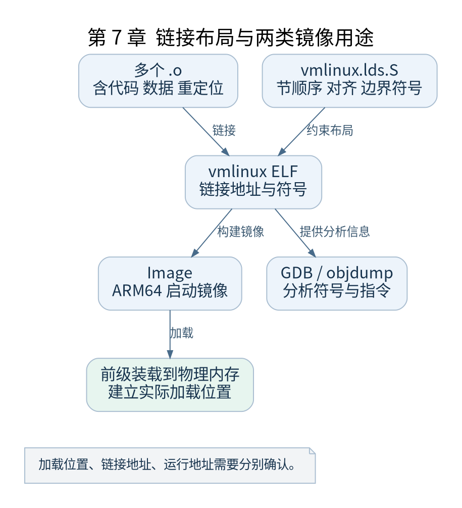

# 第 7 章 从目标文件到 vmlinux

[返回全书目录](../README.md)

CPU 最终执行的是已经链接和装载的指令。源码中的标签、对象文件中的重定位和启动时的实际地址，属于不同阶段。本章把这些阶段连接起来。



**图 7-1　链接布局与两类镜像用途**

读图提示：加载位置、链接地址、运行地址需要分别确认。 图的箭头表达标注的关系；未标明为调用的箭头，不应当作普通函数调用栈。

### 7.1 节 段与符号

ELF 的 section 服务于链接组织，program header 描述装载相关布局，symbol 给地址或其他值提供名字。`.text` 通常存放代码，`.data` 存放已初始化可写数据，`.bss` 表示运行时需要清零的区域。

符号不一定对应函数。`__bss_start`、`__bss_stop` 是边界标记；代码把它们作为地址使用，再计算需要清零的范围。把边界符号误当成可读取的普通变量，会错解启动汇编。

### 7.2 链接脚本安排运行布局

`arch/arm64/kernel/vmlinux.lds.S` 经过预处理后生成链接脚本。它安排启动头、代码、只读数据、初始化节和其他区域，也定义多个供 C 与汇编共用的边界符号。

链接器收集 initcall 对应输入节，使启动代码能够按约定范围遍历函数指针。初始化函数并不是靠扫描函数名被发现的；宏、节名和链接脚本共同建立了这项机制。

### 7.3 三种地址要分别记录

加载地址回答镜像字节放在物理内存哪里，链接地址回答符号在链接结果中取什么值，运行地址回答 CPU 当前以什么地址访问它们。在关闭 KASLR 的固定实验里关系相对稳定，但仍不能省略物理与虚拟的区分。

`kimage_voffset` 表示内核镜像相关虚实地址之间的偏移，线性映射另有布局。不能拿“内核虚拟地址减一个常数”的经验无差别转换 vmalloc、设备映射和所有符号地址。

### 7.4 为什么 Image 与 vmlinux 不同

`vmlinux` 保留 ELF 结构及调试需要的信息，`Image` 是供 ARM64 启动协议使用的镜像形式。GDB 使用前者查符号，QEMU 的 `-kernel` 在本书路径中加载后者。它们反映同一次链接结果，但文件内容和用途不同。

```sh
aarch64-linux-gnu-readelf -h work/out/vmlinux
aarch64-linux-gnu-readelf -S work/out/vmlinux
aarch64-linux-gnu-nm -n work/out/vmlinux | rg '(_text|__bss_start|__bss_stop|start_kernel)$'
```

先看 ELF 架构字段，确认不是误编译成主机程序；再看节布局及排序后的符号地址。不要把 `nm` 中的高地址直接作为 MMU 关闭时的执行断点地址。

### 7.5 初始化区域的生命周期

`__init` 代码在启动收尾阶段可以回收，持久代码和数据必须避免长期依赖其中对象。`__ref` 等标注需要结合具体引用目的理解，不能把消除 section mismatch 警告当成自动修复生命周期问题。

### 7.6 验证练习

选择 `start_kernel`、`__primary_switched` 和一个 initcall 函数，记录所属节、符号地址及反汇编入口。再选一对起止符号计算区域长度，与 `readelf` 输出比对。若差异存在，检查对齐、额外输入节以及选择的范围是否一致。

检查点：链接布局解释代码“在哪里”，调用与分支解释“如何到达”，对象生命周期解释“何时还能使用”。三项同时成立，地址推导才完整。

### 本章源码阅读入口

- [`arch/arm64/kernel/vmlinux.lds.S`](https://github.com/torvalds/linux/blob/v5.10/arch/arm64/kernel/vmlinux.lds.S)
- [`include/asm-generic/vmlinux.lds.h`](https://github.com/torvalds/linux/blob/v5.10/include/asm-generic/vmlinux.lds.h)
- [`arch/arm64/include/asm/memory.h`](https://github.com/torvalds/linux/blob/v5.10/arch/arm64/include/asm/memory.h)

从书包根目录执行以下定位命令，再打开定义或调用点上下文。搜索命中只提供位置，不能替代对配置分支与对象状态的判断。

```sh
rg -n '__bss_start|KIMAGE_VADDR' work/linux/arch/arm64/kernel/vmlinux.lds.S work/linux/include/asm-generic/vmlinux.lds.h work/linux/arch/arm64/include/asm/memory.h
```

