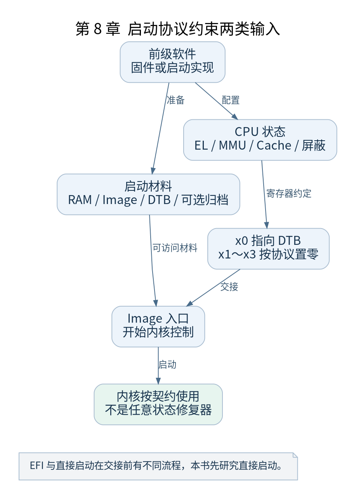

# 第 8 章 Bootloader 与内核的交接契约

[返回全书目录](../README.md)

进入 `primary_entry` 之前，内核已经依赖前级软件完成一定准备。本章以 v5.10 的 `Documentation/arm64/booting.rst` 为入口，把启动协议转换为可核对的清单。



**图 8-1　启动协议约束两类输入**

读图提示：EFI 与直接启动在交接前有不同流程，本书先研究直接启动。 图的箭头表达标注的关系；未标明为调用的箭头，不应当作普通函数调用栈。

### 8.1 交接材料与交接状态

前级软件需要准备 RAM、设备树和内核镜像。压缩镜像的解压责任应按所选启动路径判断，不能把 x86 的内核自解压过程直接搬到 ARM64 Image 说明中。initramfs 若由外部提供，其位置与大小通过设备树等约定传达给内核。

进入内核时 `x0` 保存 DTB 物理地址，`x1`～`x3` 按协议置零。DTB 的对齐、大小和内存属性有明确约束；镜像放置同样受对齐及头部字段约定影响。实验中必须以 v5.10 文档及实际 Image 头为准，不能套用更早版本固定的 text_offset。

### 8.2 MMU 与 Cache 交接要求

MMU 应处于协议要求的关闭状态。镜像内容需要对 CPU 取指可见，数据 Cache 维护与中断屏蔽也有要求。这些要求的意义是避免内核面对“内存中有新指令，但 CPU 观察到旧内容”或“入口立即跳进未知中断处理”的情况。

Cache 状态不是单独一个开关就能概括。是否需要清理到一致性点、如何处理系统级 Cache，要结合硬件与协议具体条款。书中实验依赖 QEMU 的启动实现；移植到实机时需要重新核对交接责任。

### 8.3 EL1 与 EL2 两种入口

内核允许协议规定的异常级入口，不能从任意 EL 直接跳进去。`el2_setup` 会识别状态，并在相应路径中处理 EL2 控制。VHE 可能使内核保留在 EL2，本书先用不暴露 EL2 的基线配置研究 EL1 路径。

QEMU 的 `virtualization=off` 是实验控制项，它和 Linux 的 `CONFIG_ARM64_VHE` 分属虚拟硬件与软件配置两层。即使关闭某内核配置，也不能据此推断 CPU 进入内核前处于什么异常级。

### 8.4 设备树是描述而非驱动

DTB 中的 `memory` 描述 RAM，`/chosen` 可携带命令行和 initrd 信息，设备节点提供寄存器范围、中断和兼容字符串。驱动稍后读取这些描述来完成绑定与初始化。设备节点存在，并不能证明驱动已经编译或探测成功。

### 8.5 直接启动与 EFI 分开分析

本书主线由 QEMU 直接加载 Image。EFI 路径还涉及 EFI stub、固件服务和退出引导服务等边界。两者最后可汇入正常内核启动，但此前参数组织与镜像进入方式不同，因此不把 EFI 过程画成主线中必须经过的步骤。

### 8.6 实验记录

在后续物理入口断点处保存 `x0`～`x3`、`CurrentEL` 和 PC。使用 QEMU 的 `dumpdtb` 功能导出本次虚拟硬件设备树，再用 `dtc` 解码检查内存与串口描述。导出命令见附录，检查的是同一组 machine、CPU 和 SMP 参数生成的设备树。

本章检查点：为 Image、DTB、CPU 状态各写出一条必须满足的条件，并指出条件由谁建立、由谁使用。下一章开始让 CPU 执行内核的第一段指令。

### 本章源码阅读入口

- [`Documentation/arm64/booting.rst`](https://github.com/torvalds/linux/blob/v5.10/Documentation/arm64/booting.rst)
- [`arch/arm64/kernel/head.S`](https://github.com/torvalds/linux/blob/v5.10/arch/arm64/kernel/head.S)

从书包根目录执行以下定位命令，再打开定义或调用点上下文。搜索命中只提供位置，不能替代对配置分支与对象状态的判断。

```sh
rg -n 'primary_entry|el2_setup' work/linux/Documentation/arm64/booting.rst work/linux/arch/arm64/kernel/head.S
```

