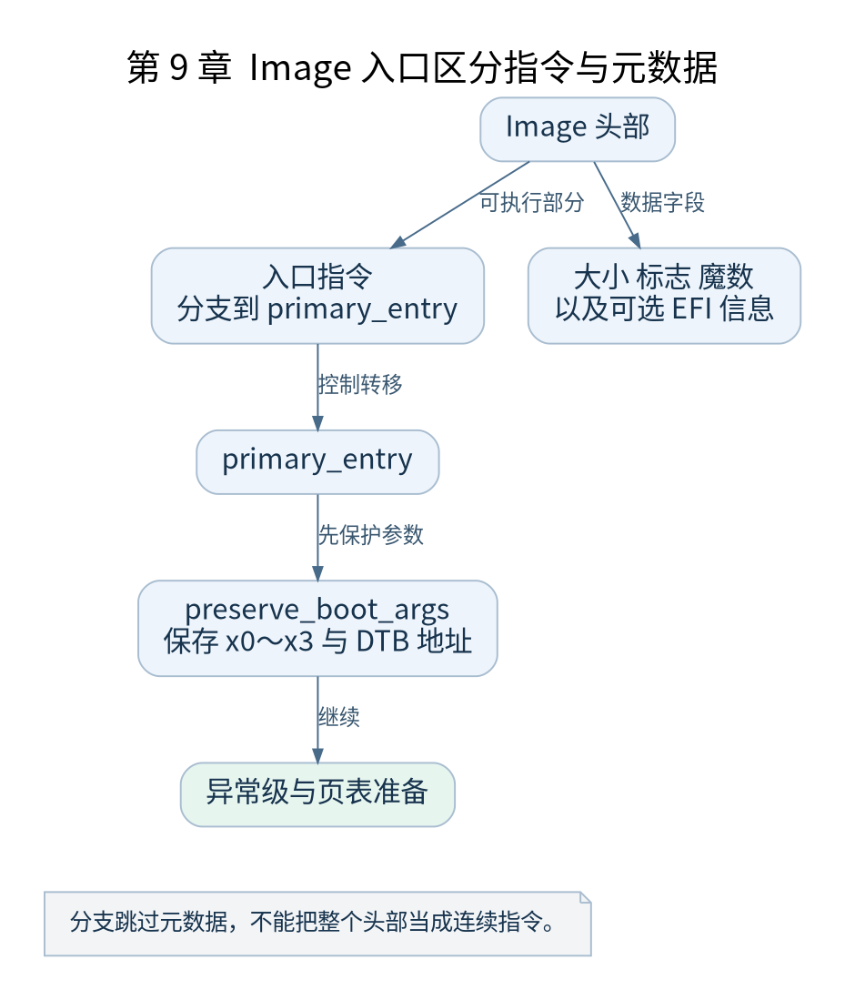

# 第 9 章 镜像头与启动入口

[返回全书目录](../README.md)

从本章开始逐段跟随 `head.S`。先确定入口和数据的边界，再解释被执行的指令。Image 头中的某些字节是元数据，不能把整个头部当作顺序执行的指令流。



**图 9-1　Image 入口区分指令与元数据**

读图提示：分支跳过元数据，不能把整个头部当成连续指令。 图的箭头表达标注的关系；未标明为调用的箭头，不应当作普通函数调用栈。

### 9.1 入口分支为什么放在镜像头

ARM64 Image 有供前级软件识别的头部布局，包括入口附近的指令、大小、标志、魔数以及可选 EFI 相关信息。在本书直接启动路径中，入口代码分支到 `primary_entry`，从而跳过不应执行的元数据。

v5.10 镜像头中的装载偏移字段应直接检查该版本源码和最终二进制，不沿用其他版本常见的固定偏移。EFI 配置还会改变头部相关指令和字段，所以观察某个 `b` 之前，先确认有效预处理分支。

### 9.2 primary_entry 的职责边界

入口依次保存启动参数、处理异常级、确定早期偏移、记录启动模式、建立初始页表、完成 CPU 设置，然后进入 MMU 切换路径。这个次序有依赖：CPU 配置和页表必须在启用转换前就绪，DTB 参数必须在相关寄存器被复用前保存。

它不是设备驱动入口，也不负责创建用户进程。阅读时将每一步记作“前提、动作、结果”：例如保存参数以前 `x0` 指向 DTB，保存以后 `x21` 跨后续若干步骤保留该地址。

### 9.3 preserve_boot_args 保住什么

该函数将入口的寄存器参数保存到适当位置，并维护早期内存可见性。保存 `x0`～`x3` 的好处是后续可以在寄存器被覆盖之后继续知道入口状态。`x21` 的长期用途则由这条启动路径自己的寄存器约定保证。

这里能运行一个汇编子程序，不代表普通内核栈已经建立。早期函数可以通过寄存器保存返回地址和临时值，或者使用专门约定的资源；不能凭看见 `bl` 就推断存在完整 C 栈帧。

### 9.4 一个具体跟踪方法

在纸上建立五列：当前 PC、当前 EL、MMU 状态、`x0`、`x21`。首先填入启动协议提供的值，然后沿 `preserve_boot_args` 更新。某列没有被当前指令改变就保留旧值；未知值标记未知，不能用零填补。

接着增加 `x23`：代码结合镜像物理放置和相关对齐处理早期偏移，KASLR 路径还会进一步使用它。不要把这个寄存器在整个启动期间都解释成同一常数。

### 9.5 验证与故障含义

使用 `objdump -d` 检查入口附近真实指令，结合 `readelf`、`nm` 和镜像文件头确认同一构建。若入口断点能够命中但后续没有输出，先逐步检查参数保存和异常级路径，而不是立即怀疑用户态 init。

本章检查点：解释入口为何不会顺序执行 Image 头中的全部字段；指出在栈正式设置之前，一次子程序调用如何仍然能够返回。下一章专门研究异常级处理。

### 本章源码阅读入口

- [`arch/arm64/kernel/head.S`](https://github.com/torvalds/linux/blob/v5.10/arch/arm64/kernel/head.S)

从书包根目录执行以下定位命令，再打开定义或调用点上下文。搜索命中只提供位置，不能替代对配置分支与对象状态的判断。

```sh
rg -n 'primary_entry|preserve_boot_args' work/linux/arch/arm64/kernel/head.S
```

