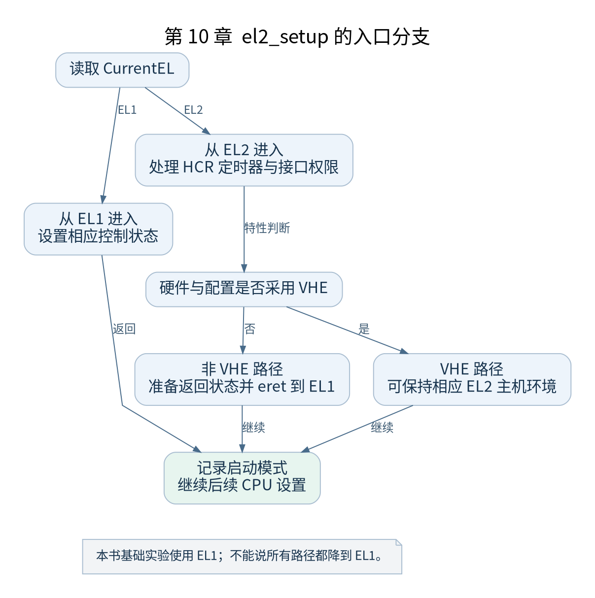

# 第 10 章 异常级与 CPU 初始状态

[返回全书目录](../README.md)

`el2_setup` 把进入内核时的执行环境调整为后续代码期望的状态。这个函数包含互斥路径，必须先判断当前 EL，再决定哪些写寄存器操作会发生。



**图 10-1　el2_setup 的入口分支**

读图提示：本书基础实验使用 EL1；不能说所有路径都降到 EL1。 图的箭头表达标注的关系；未标明为调用的箭头，不应当作普通函数调用栈。

### 10.1 先读 CurrentEL

v5.10 的实现先选择相应栈指针使用方式，再读取 `CurrentEL`。从 EL1 进入时，代码设置对应控制状态并返回一个表示 EL1 启动模式的值；从 EL2 进入时，则继续处理 EL2 的控制和访问权限。

这不是让 CPU 从任意状态恢复的通用入口。若前级违反协议，从不允许的环境跳入内核，后面的比较并不能替代所有缺失的初始化。

### 10.2 EL2 路径为什么要处理访问控制

即使目标是让内核运行于 EL1，EL2 仍可能决定 EL1 能否访问定时器、某些系统寄存器或中断接口。若前级留下拦截设置，EL1 看似普通的访问可能陷入更高异常级。

因此该路径配置 `HCR_EL2`，处理通用定时器访问和计数偏移，并根据 CPU 特性处理 GIC 系统寄存器等状态。每段代码都对应具体权限或运行条件，不是为了“多初始化一些寄存器”。

### 10.3 VHE 使路径产生分歧

当配置与硬件同时满足 VHE 条件时，内核可按相应模式运行于 EL2。此时代码对部分寄存器访问的解释、返回方式和后续虚拟化设置会不同。书中基础实验不暴露这一分支，因此先读 `x2` 表示非 VHE 的路径，再把 VHE 当扩展练习。

请注意版本：v5.10 的相关逻辑仍在这里的 `head.S` 中。其他版本可能重构为额外头文件或新函数名，本书不把新版本的组织方式移植到旧源码里。

### 10.4 eret 完成什么

对于需要离开 EL2 的路径，代码准备较低异常级的控制状态，把目标执行位置写到相应异常返回地址寄存器，将目标状态写入保存状态寄存器，再执行 `eret`。硬件根据这些寄存器完成异常返回。

普通 `ret` 只是按链接寄存器跳转，不能代替异常级切换。因此读最后几条指令时，必须同时追踪返回地址来源、状态值和正在使用的寄存器组。

### 10.5 如何观察这一分支

先在基础 QEMU 配置中记录实际入口 EL，再用暴露 EL2 的机器参数作为第二次实验。两次使用相同 Image，比较入口状态和所走分支。改变 CPU 模型还可能改变特性检测结果，应把模型名称一并记录。

检查点：把“CPU 初始位于 EL2”“内核启用了 VHE 配置”“内核最后运行在 EL2”写成三个不同事实，说明后两者还需要哪些条件。完成后再进入页表建立阶段。

### 本章源码阅读入口

- [`arch/arm64/kernel/head.S`](https://github.com/torvalds/linux/blob/v5.10/arch/arm64/kernel/head.S)

从书包根目录执行以下定位命令，再打开定义或调用点上下文。搜索命中只提供位置，不能替代对配置分支与对象状态的判断。

```sh
rg -n 'el2_setup|HCR_EL2|hcr_el2' work/linux/arch/arm64/kernel/head.S
```

