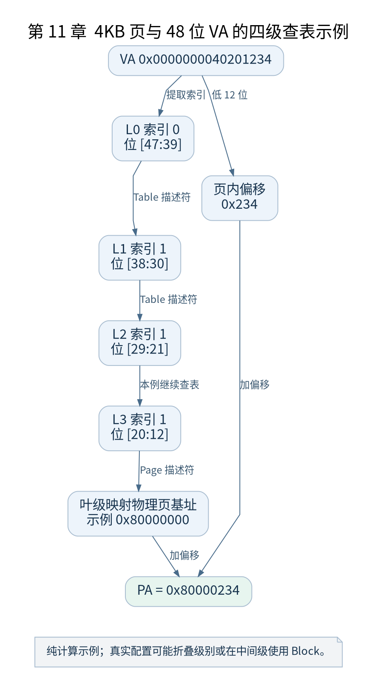

# 第 11 章 构造最初的页表

[返回全书目录](../README.md)

早期页表的目的，是让 CPU 能够可靠地跨越开启 MMU 的边界，并进入内核虚拟地址布局。此时无需为所有设备和全部内存建立最终映射，但接下来要取指、使用的栈与数据必须可达。



**图 11-1　4KB 页与 48 位 VA 的四级查表示例**

读图提示：纯计算示例；真实配置可能折叠级别或在中间级使用 Block。 图的箭头表达标注的关系；未标明为调用的箭头，不应当作普通函数调用栈。

### 11.1 页表也是内存中的数据

页表不是 CPU 内部一张自动生成的表。内核先准备存放描述符的物理内存，再写入表项，最后把表基址及转换规则告诉 CPU。早期表空间由镜像及链接布局预留，避免依赖尚未初始化的普通分配器。

`__create_page_tables` 先处理相关 Cache 状态并清空初始表区域，再构造需要的映射。清零意味着未显式建立的条目保持无效；否则旧内容可能被误解释为合法描述符。

### 11.2 两类映射要分别看

`idmap_pg_dir` 用于覆盖过渡代码相关的恒等映射。CPU 启用 MMU 后，仍能继续执行关键过渡指令。`init_pg_dir` 建立启动阶段的内核映射，后续在此基础上完成切换。

恒等映射不是要求整片 RAM 永远满足 VA 等于 PA。它覆盖特定范围并服务于特定过渡。后续地址空间调整中，可以拆除或隔离相应映射。

### 11.3 以 4KB 页和 48 位 VA 理解索引

这是计算示例，不强迫所有构建都使用该宽度。4KB 页偏移占 12 位，每张 4KB 表可以放 512 个 8 字节表项，因此每级索引占 9 位。48 位 VA 的四级示例依次使用位段 `[47:39]`、`[38:30]`、`[29:21]`、`[20:12]` 和 `[11:0]`。

对 `VA = 0x0000000040201234`，四级索引分别为 0、1、1、1，页内偏移为 `0x234`。若最后一级描述符指向物理页基址 `0x80000000`，则最终 PA 为 `0x80000234`。这只是手算表项关系，不是本书 Image 的真实映射。

### 11.4 Table 与 Block 描述符

中间层描述符可能指向下一张表，也可能在允许的层级直接表示大块映射。以有效的四级 4KB 示例为例，某些中间层可使用 1GB 或 2MB block，叶级 page 对应 4KB。早期内核尽量利用合适粒度减少表空间，但会受到对齐、范围和属性要求限制。

因此看到一个有效 PMD 项，不应立刻把它当成下一张 PTE 表。先检查描述符类型；若它是 block，转换就在该层结束，再加上相应块内偏移。

### 11.5 验证与检查点

附录的 `walk-va.py` 仅分解索引，不读取真实页表。先用它核对手算，再在 GDB 中读取实际描述符；读取时要明确表地址目前应按物理还是虚拟解释。

本章检查点：假定首级表已正确，第二级条目无效，CPU 会在什么位置失败？答案是地址转换阶段，不会自动跳过该级去物理内存找数据。页表错误必须先定位失败层级，再谈代码逻辑。

### 本章源码阅读入口

- [`arch/arm64/kernel/head.S`](https://github.com/torvalds/linux/blob/v5.10/arch/arm64/kernel/head.S)
- [`arch/arm64/include/asm/pgtable-hwdef.h`](https://github.com/torvalds/linux/blob/v5.10/arch/arm64/include/asm/pgtable-hwdef.h)

从书包根目录执行以下定位命令，再打开定义或调用点上下文。搜索命中只提供位置，不能替代对配置分支与对象状态的判断。

```sh
rg -n '__create_page_tables|idmap_pg_dir|init_pg_dir' work/linux/arch/arm64/kernel/head.S work/linux/arch/arm64/include/asm/pgtable-hwdef.h
```

