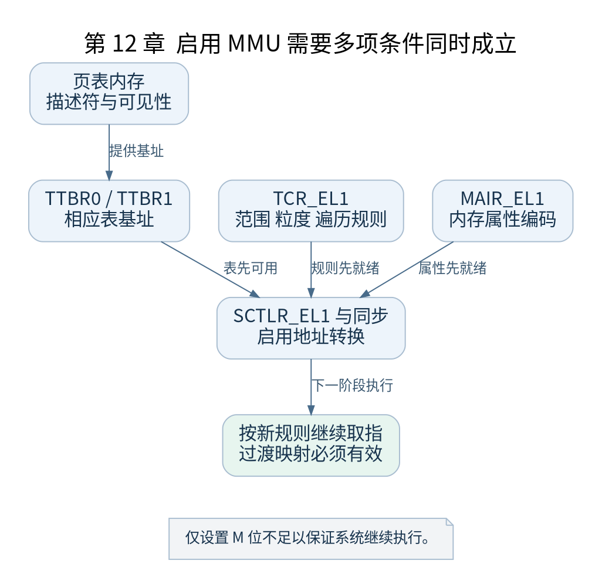

# 第 12 章 初始化 CPU 并打开 MMU

[返回全书目录](../README.md)

上一章写好了表，本章研究 CPU 如何采用这些表。完整条件包含表内容、表基址、转换规则、内存属性和必要同步，不能简化为把一个 M 位从零改为一。



**图 12-1　启用 MMU 需要多项条件同时成立**

读图提示：仅设置 M 位不足以保证系统继续执行。 图的箭头表达标注的关系；未标明为调用的箭头，不应当作普通函数调用栈。

### 12.1 __cpu_setup 准备控制规则

`arch/arm64/mm/proc.S` 中的 `__cpu_setup` 检测相关 CPU 特性，准备 `MAIR_EL1`、`TCR_EL1` 以及后续使用的控制值。转换粒度、物理地址范围和虚拟地址范围必须互相匹配，也必须被 CPU 支持。

`MAIR_EL1` 提供属性编码，页表描述符中的属性索引选择这些编码。`TCR_EL1` 决定转换范围和遍历规则。描述符单独看似正确，若转换规则解释成另一粒度，最终也不能得到期望映射。

### 12.2 __enable_mmu 的关键顺序

v5.10 的实现检查所需转换粒度是否受支持，准备页表基址编码，将 `idmap_pg_dir` 相关基址写入 `TTBR0_EL1`，把内核启动表相关基址写入 `TTBR1_EL1`，完成相应同步后写入 `SCTLR_EL1`，再执行所需指令与 Cache 同步。

图中 TTBR0 服务过渡恒等映射，不能据此把正常运行时“TTBR0 对用户地址”的经验直接套到每个早期指令上。寄存器的作用由当前阶段的表和配置决定。

### 12.3 为什么下一条指令还能执行

启用转换后，后续执行地址必须按新规则得到有效映射。过渡代码位于适当的恒等映射范围，之后再通过内核映射中的目标地址继续执行。对读者最有效的验证，是写出开启前的 PC 数值、开启后的解释和接下来显式分支的目标。

失败时可能表现为预取异常或进入尚不可用的异常处理路径，最终看起来像“卡住”。这类问题通常早于串口初始化，使用单步和异常状态比等待日志更有用。

### 12.4 屏障不只是形式

`isb` 让后续指令执行按架构要求观察上下文变化；`dsb` 等指令提供相应内存操作完成与顺序保证。清理或失效 Cache、更新页表、修改控制寄存器之间有明确要求。不能因为 QEMU 上删掉某条屏障暂时还能启动，就断言实机也不需要它。

本章不提供随意修改启动屏障的实验。验证重点是观察原代码依赖，而不是用未出错一次代替体系结构正确性证明。

### 12.5 验证与检查点

在 `__enable_mmu` 前后记录 TTBR、TCR、SCTLR 以及 PC；GDB 能显示的系统寄存器名称取决于 QEMU 和 GDB 版本，可使用 `info all-registers` 确认。未暴露的寄存器需要使用调试日志或受控插桩观察，不能编造不存在的调试器表达式。

检查点：页表正确但 TCR 的粒度错误为什么仍会失败？因为 CPU 使用控制规则解释表内存，双方对描述符布局和索引方式的理解不一致。

### 本章源码阅读入口

- [`arch/arm64/mm/proc.S`](https://github.com/torvalds/linux/blob/v5.10/arch/arm64/mm/proc.S)
- [`arch/arm64/kernel/head.S`](https://github.com/torvalds/linux/blob/v5.10/arch/arm64/kernel/head.S)

从书包根目录执行以下定位命令，再打开定义或调用点上下文。搜索命中只提供位置，不能替代对配置分支与对象状态的判断。

```sh
rg -n '__cpu_setup|__enable_mmu' work/linux/arch/arm64/mm/proc.S work/linux/arch/arm64/kernel/head.S
```

