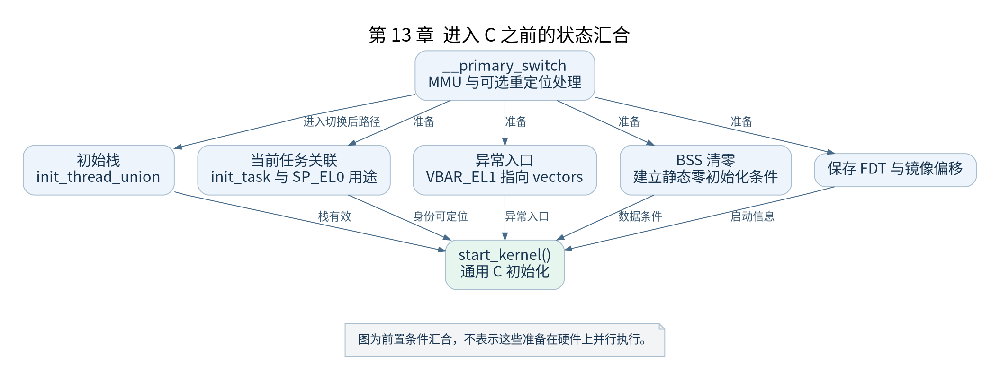

# 第 13 章 从汇编进入 start_kernel

[返回全书目录](../README.md)

`__primary_switch` 把启用转换、镜像重定位和进入正常虚拟地址执行连接起来，`__primary_switched` 再建立进入通用 C 初始化前的状态。这一章把前几章的寄存器与内存知识汇合起来。



**图 13-1　进入 C 之前的状态汇合**

读图提示：图为前置条件汇合，不表示这些准备在硬件上并行执行。 图的箭头表达标注的关系；未标明为调用的箭头，不应当作普通函数调用栈。

### 13.1 切换不总是只走一次

关闭 KASLR 的基线较简单。启用重定位和随机化后，代码可能先计算偏移，再重建相应映射并再次完成切换。必须按有效配置阅读分支，而不能把某次返回当成普通函数即将结束。

`__primary_switch` 使用相关加载方式取得 `__primary_switched` 的运行目标，后者此时在内核映射下执行。这里正是“当前镜像物理位置”和“链接符号地址”需要联合推导的地方。

### 13.2 初始栈与当前任务

`__primary_switched` 根据 `init_thread_union` 设置初始栈顶，并把 `init_task` 关联到当前任务定位所需状态。v5.10 的这段代码将相应值写入 `SP_EL0`；这里暂时使用它保存当前任务信息，不应把它解释成已经给用户程序准备好的用户栈。

随后安装 `VBAR_EL1`，建立必要帧状态，保存 DTB 指针与镜像偏移。实际使用的 `current` 定位方式应结合该版本 ARM64 头文件和异常入口一同理解。

### 13.3 BSS 为何必须清零

C 的静态存储期对象可能依赖零初始化语义。链接器用边界描述 BSS 范围，启动代码将它清零，并按需要进行同步。这件事需要发生在通用 C 初始化依赖这些对象之前。

源码中的特殊区域与提前写入值要结合链接布局检查，不能推断“清 BSS 会把所有之前保存的参数都清掉”。对象被放在哪个节，决定它是否处于这次清零范围。

### 13.4 如何设置物理阶段断点

在 MMU 已开启且地址布局固定时，可直接按符号设置 `start_kernel` 断点。更早的 `primary_entry` 需要推导实际物理位置。对于已确认 Image 首地址与 `_text` 对应的基线，可以使用：`入口物理地址 = Image 实际物理首地址 + (入口符号链接地址 - _text 链接地址)`。

公式的前提必须验证。不要把一个 QEMU 版本中观察到的 Image 放置地址当成协议常数。先用 QEMU 启动状态、内存内容或加载日志确认 Image 实际位置，再设置数值硬件断点。

### 13.5 本章验收

在进入 `start_kernel` 前，记录栈顶是否落在预期区域、BSS 清零范围、DTB 保存位置、向量表地址及当前 MMU 状态。任一项不清楚，都可以回到对应汇编语句与链接边界验证。

到达 `start_kernel()` 只意味着 C 初始化条件已建立，下一篇还要让内核具备可分配、可响应和可调度的能力。

### 本章源码阅读入口

- [`arch/arm64/kernel/head.S`](https://github.com/torvalds/linux/blob/v5.10/arch/arm64/kernel/head.S)
- [`arch/arm64/include/asm/thread_info.h`](https://github.com/torvalds/linux/blob/v5.10/arch/arm64/include/asm/thread_info.h)

从书包根目录执行以下定位命令，再打开定义或调用点上下文。搜索命中只提供位置，不能替代对配置分支与对象状态的判断。

```sh
rg -n '__primary_switch|__primary_switched|sp_el0' work/linux/arch/arm64/kernel/head.S work/linux/arch/arm64/include/asm/thread_info.h
```

