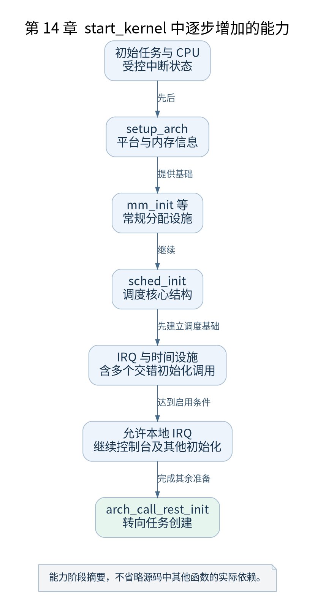

# 第 14 章 start_kernel 的初始化顺序

[返回全书目录](../README.md)

`start_kernel()` 很长，本章采用“能力何时可用”的方法拆解。先准确保留顺序，再把相邻代码按问题组织，避免为了讲解方便把真实调用关系改写。



**图 14-1　start_kernel 中逐步增加的能力**

读图提示：能力阶段摘要，不省略源码中其他函数的实际依赖。 图的箭头表达标注的关系；未标明为调用的箭头，不应当作普通函数调用栈。

### 14.1 入口阶段的基础状态

函数先处理初始任务栈标记、启动 CPU 身份和早期核心状态，确保中断处于受控屏蔽状态，建立启动 CPU 记录，再进入架构设置。部分日志此时写入日志系统，并不意味着所有控制台已经可用。

`setup_arch()` 是平台识别、内存布局和架构初始化的重要入口，返回命令行等信息。此后通用代码继续准备命令行、每 CPU 区域以及其他基础状态。

### 14.2 内存初始化与调度器

沿 v5.10 实际代码，可以看到 `mm_init()` 承担页扩展、正式内存分配及相关设施的初始化，`sched_init()` 随后建立调度器核心数据。调度器要在允许早期中断驱动的活动之前达到相应可用状态。

这不代表调度拓扑已经最终完成，也不代表允许任意位置睡眠。源码随后明确控制抢占状态，并在多核准备完成后进一步建立调度约束。

### 14.3 中断 时间与工作队列

早期 workqueue 初始化先允许相应对象和工作项管理，真正工作执行还依赖后续内核线程基础设施。RCU、IRQ 描述符、中断控制器、tick、定时器、软中断和时间保持等代码按依赖推进。

`init_IRQ()` 与 `time_init()` 之间还交错多个初始化函数。书中的阶段图表示能力群组，不能当成删去中间调用后的精确函数栈。准确顺序以本次源码和配置为准。

### 14.4 开启 IRQ 是一个边界

在完成适当准备之后，代码清除早期中断禁止标志并启用本地 IRQ。到这里，异步事件开始更直接地参与系统运行。随后仍有控制台、缓存、VFS 等初始化，以及进入后续启动任务创建的路径。

`system_state` 记录内核启动状态的变化，但它不是所有资源就绪的一张万能证书。接口能否使用，仍需检查具体子系统和上下文约束。

### 14.5 用日志与断点交叉定位

本章建议断点依次设在 `start_kernel`、`setup_arch`、`mm_init`、`sched_init`、`init_IRQ`、`time_init` 和 `rest_init`。不要一次给大量高频函数打断点，否则输出会淹没启动边界。

为每次停止记录：任务身份、中断状态、此后新增能力。断点未命中时先排除内联、优化、符号不匹配和配置裁剪，再判断执行路径改变。局部变量被优化掉，不代表源代码中的值从未存在。

本章检查点：举出一个“对象可以注册，但工作尚不能执行”的启动例子，并解释依赖尚未满足在哪里。带着依赖关系进入后续内存章节，会更容易理解顺序。

### 本章源码阅读入口

- [`init/main.c`](https://github.com/torvalds/linux/blob/v5.10/init/main.c)

从书包根目录执行以下定位命令，再打开定义或调用点上下文。搜索命中只提供位置，不能替代对配置分支与对象状态的判断。

```sh
rg -n 'start_kernel|mm_init|arch_call_rest_init' work/linux/init/main.c
```

