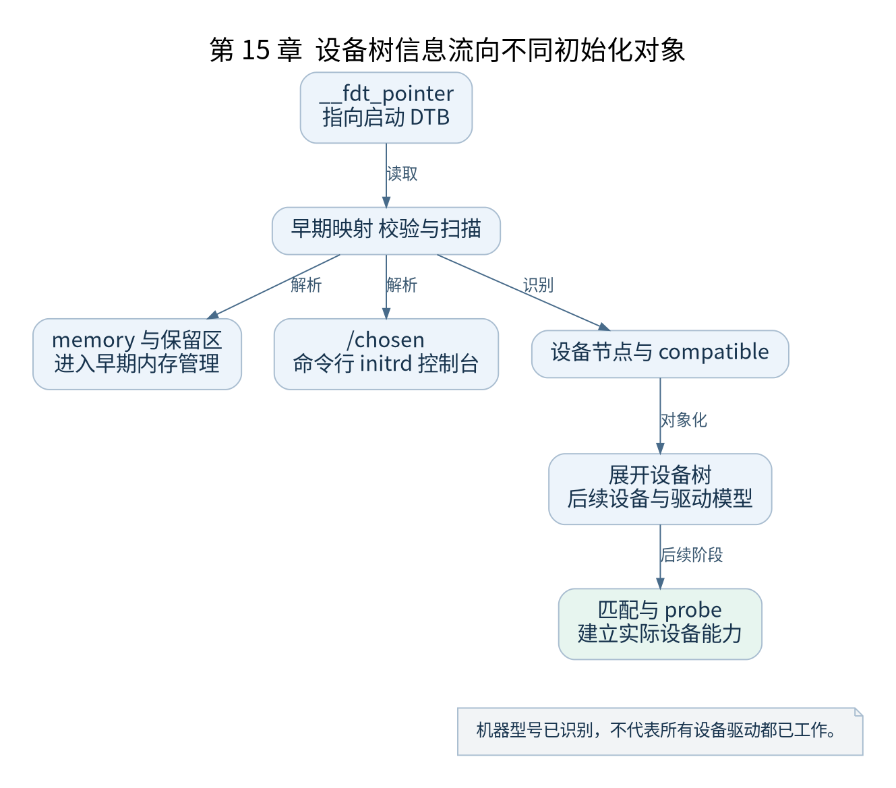

# 第 15 章 setup_arch 与平台识别

[返回全书目录](../README.md)

`setup_arch()` 将启动入口得到的信息转换成通用内核可使用的架构与平台状态。本书使用设备树路径，ACPI 等其他路径只作为边界提示，不与设备树流程合并成必经步骤。



**图 15-1　设备树信息流向不同初始化对象**

读图提示：机器型号已识别，不代表所有设备驱动都已工作。 图的箭头表达标注的关系；未标明为调用的箭头，不应当作普通函数调用栈。

### 15.1 从 DTB 物理地址开始

入口保存的 `__fdt_pointer` 由 `setup_machine_fdt()` 等路径使用。内核需要建立适当早期映射、校验设备树并解析必要属性。校验失败可能使启动在普通驱动探测前就停止。

早期 DTB 仍是扁平化二进制结构。此时可以扫描它，不需要先为每个设备构造完整对象。后续 `unflatten_device_tree()` 等操作才建立便于常规内核使用的树状表示。

### 15.2 三类信息如何向下游流动

内存节点帮助识别 RAM 范围；保留区域与其他约定使内核避免覆盖固件、DTB 或特定用途内存；`/chosen` 提供命令行、initrd 及控制台等启动信息。

这些信息并非最终直接等于“伙伴系统可分配页”。内核还要考虑镜像占用、对齐、寻址范围、保留区以及内存模型。物理 RAM 存在与可以立即分配，是不同条件。

### 15.3 命令行的多个版本

Bootloader 传入的命令行、内核保存的字符串和解析时使用的副本承担不同用途。某些解析会修改缓冲区，因此源码保留原始记录与可修改副本。分析 `console=`、`root=`、`init=` 时，先找参数登记，再看哪个阶段消费它。

`early_param` 在早期阶段处理需要尽快生效的参数；普通 `__setup` 和通用参数解析有自己的时机。不要认为命令行中的所有项都在 `setup_arch` 内一次处理完。

### 15.4 平台描述与设备探测的边界

早期识别 CPU、串口及中断控制器所需信息，与稍后驱动模型创建设备并绑定驱动是分阶段完成的。设备树 `compatible` 能帮助选择驱动，但还受编译配置和资源就绪情况约束。

因此启动日志中已经打印机器型号，并不能证明 UART、块设备或网络设备都能工作。下一步应查看对应驱动探测与返回值。

### 15.5 验证练习

导出本次 QEMU DTB，用 `dtc -I dtb -O dts` 解码，定位内存范围、`/chosen` 和串口节点。与启动日志中的命令行和可用内存对照；记录保留区域导致的差异，不要强求 RAM 总字节数等于日志中的可用字节数。

检查点：为什么在常规堆分配器可用前仍能读取设备树？因为扁平结构可在适当映射下按格式扫描，完整对象化不是读取最早期必要信息的前提。

### 本章源码阅读入口

- [`arch/arm64/kernel/setup.c`](https://github.com/torvalds/linux/blob/v5.10/arch/arm64/kernel/setup.c)
- [`drivers/of/fdt.c`](https://github.com/torvalds/linux/blob/v5.10/drivers/of/fdt.c)

从书包根目录执行以下定位命令，再打开定义或调用点上下文。搜索命中只提供位置，不能替代对配置分支与对象状态的判断。

```sh
rg -n 'setup_arch|setup_machine_fdt|early_init_dt_scan_nodes' work/linux/arch/arm64/kernel/setup.c work/linux/drivers/of/fdt.c
```

