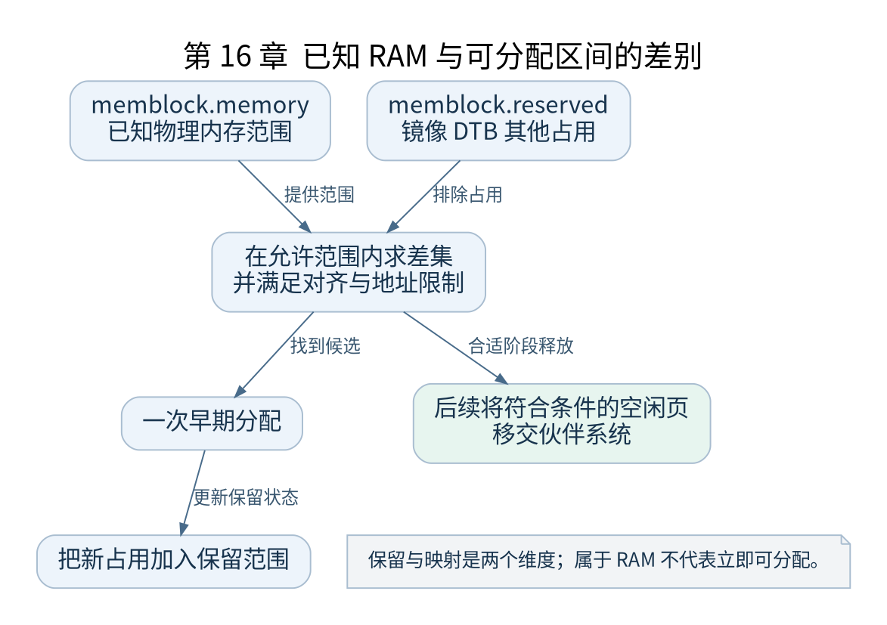

# 第 16 章 memblock 与早期内存分配

[返回全书目录](../README.md)

在页分配器可用之前，内核仍需要记录 RAM、保护关键区域并为页表等对象分配空间。memblock 用范围管理满足这些需求，并在后续把合适内存移交给正式分配器。



**图 16-1　已知 RAM 与可分配区间的差别**

读图提示：保留与映射是两个维度；属于 RAM 不代表立即可分配。 图的箭头表达标注的关系；未标明为调用的箭头，不应当作普通函数调用栈。

### 16.1 memory 与 reserved 两类范围

`memblock.memory` 记录内存范围，`memblock.reserved` 记录应避免分配的保留范围。一个区域可以属于已知 RAM，同时被保留。例如内核 Image 位于 RAM 中，但不能作为空闲空间交给新页表使用。

`memblock_add()` 表达发现可管理内存，`memblock_reserve()` 表达保护区间。区间处理涉及合并、切分、对齐与标志，不是为每个字节建立一个对象。

### 16.2 一次早期分配如何选择位置

分配请求提供大小、对齐及可用地址约束。memblock 在允许的 memory 范围中寻找不与 reserved 冲突的区间，成功后把新范围保留，返回适当形式的地址。不同接口返回物理地址或映射后的指针，调用者必须按接口语义使用。

教学例子：RAM 为 `[0x40000000, 0x48000000)`，Image 保留 `[0x40200000, 0x41200000)`。请求一个对齐为 4KB 的 8KB 区间时，只能从剩余允许范围中选择。实际选择还受搜索方向、上限和其他保留区影响，不能只凭图中的左侧空洞断言一定返回最低地址。

### 16.3 保留不等于永不释放

保留可能是永久的，也可能只覆盖初始化阶段。DTB、initrd、初始化区域及特定架构资源的回收时机由各自生命周期决定。未经条件检查就取消保留，可能让正式分配器重用仍被引用的内存。

### 16.4 memblock 到伙伴系统

`bootmem_init()` 等路径准备内存模型与区域信息；后续 `mem_init()` 会调用适当的移交逻辑，`memblock_free_all()` 将满足条件的空闲页交给页分配器。不是把每个 memblock 对象转换成一个伙伴块，而是利用已知范围和保留情况释放可用页。

移交也不意味着所有 memblock 相关元数据立刻从系统中消失。是否保留以及何时回收取决于配置和架构后续需要。

### 16.5 验证与检查点

尝试在内核命令行加入 `memblock=debug`，结合日志观察添加、保留和分配。若相关输出未出现，检查参数支持、日志级别和控制台时机，再在关键函数断点读取结构。

练习：给三个区间分别标注 RAM、reserved、可分配，计算两者差集。再说明“物理地址属于 RAM”“已建立虚拟映射”“可以通过 kmalloc 得到”为什么是三个不同结论。

### 本章源码阅读入口

- [`mm/memblock.c`](https://github.com/torvalds/linux/blob/v5.10/mm/memblock.c)
- [`arch/arm64/mm/init.c`](https://github.com/torvalds/linux/blob/v5.10/arch/arm64/mm/init.c)

从书包根目录执行以下定位命令，再打开定义或调用点上下文。搜索命中只提供位置，不能替代对配置分支与对象状态的判断。

```sh
rg -n 'memblock_add|memblock_reserve|memblock_free_all|bootmem_init' work/linux/mm/memblock.c work/linux/arch/arm64/mm/init.c
```

