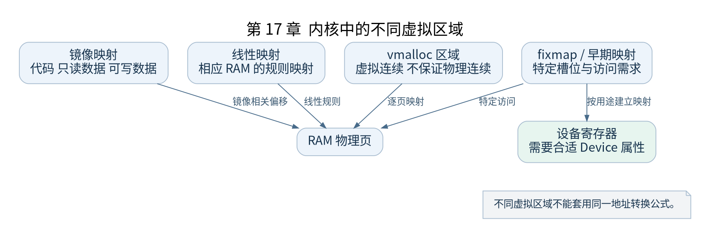

# 第 17 章 建立正式的内核地址空间

[返回全书目录](../README.md)

早期页表只解决启动所需访问。为了管理更多内存并实施权限保护，ARM64 还要建立更完整的内核映射。这里的“正式”表示走向常规运行布局，不代表以后页表永远不再变化。



**图 17-1　内核中的不同虚拟区域**

读图提示：不同虚拟区域不能套用同一地址转换公式。 图的箭头表达标注的关系；未标明为调用的箭头，不应当作普通函数调用栈。

### 17.1 内核镜像映射与线性映射

内核镜像映射覆盖链接布局中的代码、只读数据和可写数据，便于按各自权限访问。线性映射提供对相应物理内存范围的规则映射，供内核管理 RAM。它们可能使同一物理页通过不同虚拟地址被访问。

镜像符号的虚实转换使用镜像相关偏移，线性映射的转换使用对应地址布局。`vmalloc` 区域、设备映射和用户地址不能不加区分地套用线性转换公式。

### 17.2 paging_init 的主要工作

`arch/arm64/mm/mmu.c` 中的 `paging_init()` 组织内核映射、内存映射及页表切换相关工作。内部使用建立映射的辅助函数，并根据范围、对齐和属性决定采用表还是块映射。

阅读时沿“分配页表页、填描述符、使 CPU 采用适当表”三个动作追踪。它们不一定紧挨着出现，部分资源来自早期分配设施，部分映射又依赖前面架构内存探测的结果。

### 17.3 权限如何表达

代码区应可执行并受写保护，部分数据应只读且不可执行，可写数据则不应随意可执行。具体策略受到 `CONFIG_STRICT_KERNEL_RWX` 等配置以及启动阶段影响。

同一物理页若存在多个映射别名，保护分析还需检查别名权限；只发现一个只读 PTE，并不足以证明该物理页通过任何入口都不可写。书中后续释放初始化内存与设置只读保护，也必须和这里的映射生命周期联系起来。

### 17.4 fixmap 与早期设备访问

内核需要临时或固定位置访问尚未建立常规映射的对象。fixmap 提供一组预定虚拟槽位；早期映射设施可利用它满足访问需求。它不是所有外设映射的统一永久存储区。

UART 等设备寄存器映射还要使用正确内存属性。地址可访问与设备行为正确之间，隔着属性、访问宽度和设备协议三项条件。

### 17.5 验证练习

对照 `Documentation/arm64/memory.rst` 和本次 `.config`，画出用户范围、线性映射、镜像、vmalloc 与 fixmap 的概念位置。绝对地址需按有效 VA 宽度推导，不要把文档中某张特定配置表当成全部配置。

检查点：选择内核代码符号和一个 `kmalloc` 对象，分别说明预期属于哪类映射；再指出为什么用户程序中的任意数值指针不能直接交给这些转换宏处理。

### 本章源码阅读入口

- [`arch/arm64/mm/mmu.c`](https://github.com/torvalds/linux/blob/v5.10/arch/arm64/mm/mmu.c)
- [`Documentation/arm64/memory.rst`](https://github.com/torvalds/linux/blob/v5.10/Documentation/arm64/memory.rst)

从书包根目录执行以下定位命令，再打开定义或调用点上下文。搜索命中只提供位置，不能替代对配置分支与对象状态的判断。

```sh
rg -n 'paging_init|map_mem|map_kernel' work/linux/arch/arm64/mm/mmu.c work/linux/Documentation/arm64/memory.rst
```

