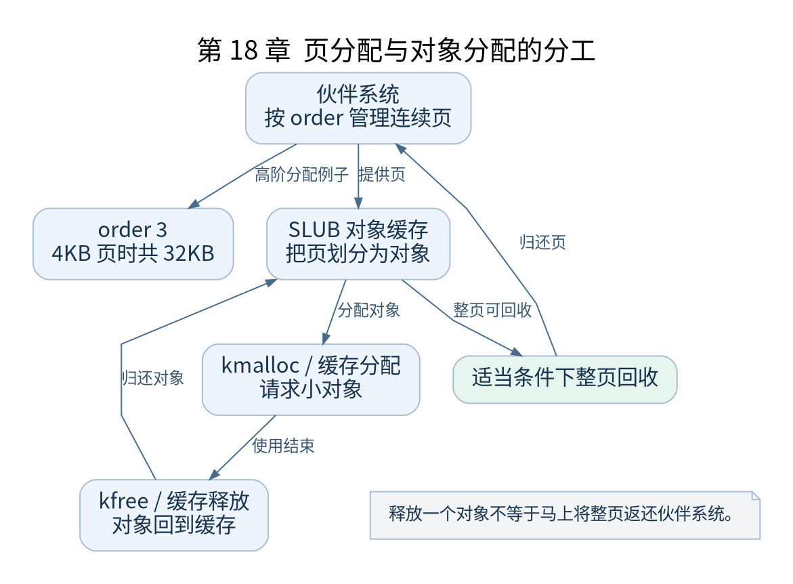

# 第 18 章 伙伴系统与 SLUB

[返回全书目录](../README.md)

从本章开始，内核逐步拥有常规动态分配能力。理解两层分配器的分工，有助于解释页表、任务结构和内核栈等对象从哪里获得存储。



**图 18-1　页分配与对象分配的分工**

读图提示：释放一个对象不等于马上将整页返还伙伴系统。 图的箭头表达标注的关系；未标明为调用的箭头，不应当作普通函数调用栈。

### 18.1 struct page 描述物理页

物理页内容与描述它的 `struct page` 不是同一块东西。描述符保存状态、引用计数和管理信息；页本身保存代码、对象或文件数据。内存模型影响页帧号到描述符的关系，不应把两者地址直接当成简单恒等关系。

节点和 zone 把物理内存按拓扑与访问约束组织起来。即便只研究单节点 QEMU，分配接口仍使用这套通用结构，因此代码中出现节点并不表示实验必须有真实 NUMA 硬件。

### 18.2 伙伴系统管理连续页块

order 为 n 的分配请求大小为 `2^n` 个连续页。以 4KB 页为例，order 0 是 4KB，order 3 是 32KB。分配器可以拆分较大空闲块，释放时在允许条件下与对应伙伴合并。

请求总空闲内存足够不代表高阶连续块一定可用，碎片会限制连续分配。伙伴关系还受块对齐与管理边界约束，不能把任意相邻空闲页都合并成合法高阶块。

### 18.3 SLUB 管理小对象

为每个几十字节对象分配一整页会浪费空间。SLUB 利用页构造对象缓存，把一页或多页划分成固定大小对象，并维护空闲对象及每 CPU 等状态。

`kmalloc()` 根据大小及相关条件使用适当缓存或其他路径，`kmem_cache_alloc()` 则可针对特定对象缓存。对象缓存的初始化时机、构造行为和分配标志，都可能影响能否在当前上下文使用。

### 18.4 三个接口不要混用

| 接口 | 核心用途 | 释放时应匹配 |
| --- | --- | --- |
| `alloc_pages()` | 按 order 获取页 | 对应页释放接口与 order |
| `kmalloc()` | 获取内核对象存储 | `kfree()` |
| `vmalloc()` | 建立虚拟连续分配 | `vfree()` |

`vmalloc` 返回虚拟连续范围，背后不保证物理连续。`GFP_KERNEL` 可能允许阻塞，因此不能只因返回值类型相同就将它用于硬中断或任意持锁区域。

### 18.5 启动阶段如何接上来

`mm_init()` 等代码让常规页和对象分配逐步可用，SLUB 自身的早期建立又有引导过程。不要把它描述成“先调用 kmalloc 创建所有 kmalloc 内部结构”这样没有解释启动来源的循环。

验证时用启动日志记录总页与保留页，在用户空间通过 `/proc/buddyinfo` 和 `/proc/slabinfo` 观察；这些文件可见还依赖 procfs 挂载与相应配置。检查点：解释 `kmalloc` 对象生命周期结束为什么不一定马上把整页返还伙伴系统。

### 本章源码阅读入口

- [`mm/page_alloc.c`](https://github.com/torvalds/linux/blob/v5.10/mm/page_alloc.c)
- [`mm/slub.c`](https://github.com/torvalds/linux/blob/v5.10/mm/slub.c)
- [`mm/slab_common.c`](https://github.com/torvalds/linux/blob/v5.10/mm/slab_common.c)

从书包根目录执行以下定位命令，再打开定义或调用点上下文。搜索命中只提供位置，不能替代对配置分支与对象状态的判断。

```sh
rg -n '__alloc_pages_nodemask|kmem_cache_init|kmalloc' work/linux/mm/page_alloc.c work/linux/mm/slub.c work/linux/mm/slab_common.c
```

