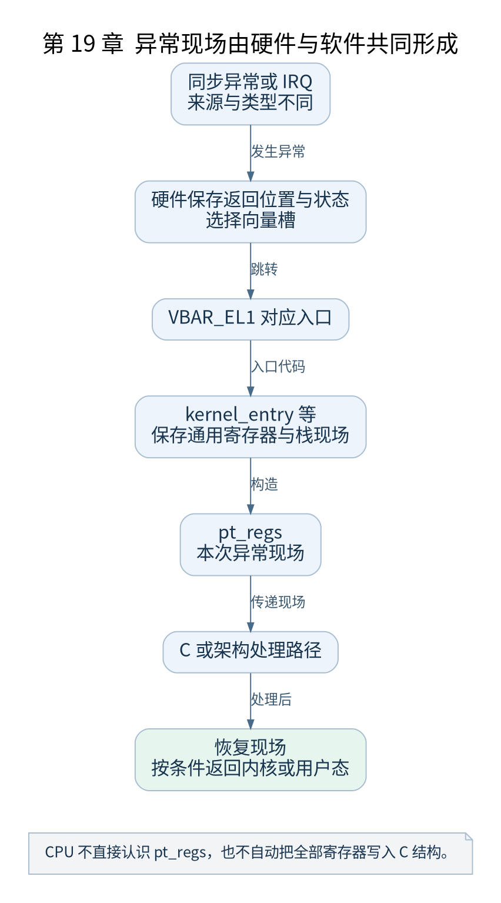

# 第 19 章 异常向量与异常现场

[返回全书目录](../README.md)

一个系统要可靠运行，必须能在当前执行流被打断后保存现场、处理事件并恢复。本章研究 ARM64 异常入口，而不是把异常、中断和调度视为同一个动作。



**图 19-1　异常现场由硬件与软件共同形成**

读图提示：CPU 不直接认识 pt_regs，也不自动把全部寄存器写入 C 结构。 图的箭头表达标注的关系；未标明为调用的箭头，不应当作普通函数调用栈。

### 19.1 异常从哪里进入

`VBAR_EL1` 指向异常向量表。AArch64 根据异常来源、所用栈及异常类型选择向量槽。向量表按体系结构要求对齐，常见布局包含 16 个入口槽，每槽预留 128 字节空间，总体按 2KB 边界对齐。

v5.10 的 `vectors` 使用 `kernel_ventry` 宏生成入口，区分 EL1t、EL1h、64 位 EL0 和兼容状态来源。不是每个槽都对应本书支持的正常路径，一些入口明确指向 invalid 处理。

### 19.2 硬件保存与软件保存

异常发生时，硬件记录相应的返回地址及状态，并跳到向量。随后汇编入口保存通用寄存器，组织 `pt_regs`，处理当前任务与栈等状态。完整现场是硬件动作与软件序列共同形成的结果。

`pt_regs` 是本次异常现场的数据表达，`thread.cpu_context` 则用于任务切换保存部分内核执行状态。二者有不同职责，不能因为都保存寄存器就合并成一个概念。

### 19.3 同步异常与 IRQ

同步异常与当前指令相关，例如系统调用或地址转换错误；IRQ 通常来自异步中断事件。两类事件进入不同分发路径，处理前需要识别来源。用户态系统调用是受控进入内核的机制，不能简单称作“程序出错”。

本书基线下，EL0 的 `svc` 会进入相应同步异常路径；IRQ 则进入如 `el1_irq` 或 `el0_irq` 的入口。FIQ 与 SError 又有不同语义，不能把所有向量都当作设备 IRQ。

### 19.4 内核栈与 IRQ 栈

异常入口可能先在任务相关栈保存现场，再按配置及路径使用每 CPU IRQ 栈等资源处理事件。发生任务切换时，也不能把 IRQ 栈误认为新任务的常驻内核栈。

读 `irq_handler` 宏时，注意它取得 `handle_arch_irq` 回调并组织调用环境。它是汇编宏，不保证存在一个可直接 `break irq_handler` 的独立函数符号。

### 19.5 恢复为什么需要完整匹配

`kernel_exit` 及相关返回路径恢复现场，最终按异常返回机制继续执行。返回用户态前还可能处理待办工作、信号和重调度需求，因此不是处理函数一返回就立即无条件执行原用户指令。

验证时从 `el1_irq` 或 `el0_sync` 等真实符号设置断点，检查 SP、`pt_regs` 中 PC 和状态。单步高频定时器可能影响观察，优先在一次受控系统调用路径中理解现场布局。

本章检查点：硬件为何不需要知道 `struct pt_regs` 的 C 定义？因为它是软件保存现场时采用的数据布局，硬件只遵守体系结构异常机制。

### 本章源码阅读入口

- [`arch/arm64/kernel/entry.S`](https://github.com/torvalds/linux/blob/v5.10/arch/arm64/kernel/entry.S)

从书包根目录执行以下定位命令，再打开定义或调用点上下文。搜索命中只提供位置，不能替代对配置分支与对象状态的判断。

```sh
rg -n 'vectors|kernel_entry|kernel_exit|el1_irq' work/linux/arch/arm64/kernel/entry.S
```

