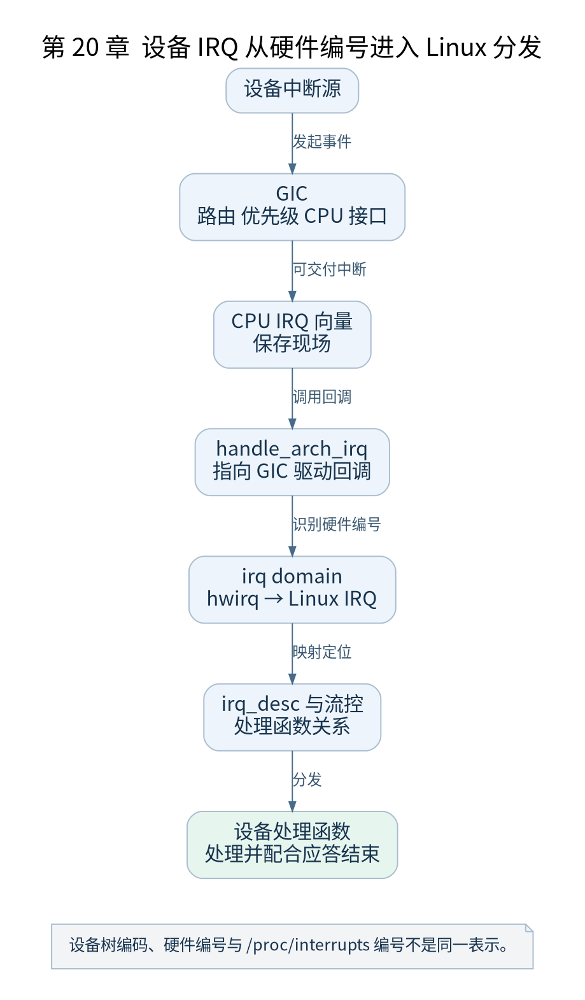

# 第 20 章 中断子系统与 GIC

[返回全书目录](../README.md)

异常入口把 CPU 带到 IRQ 处理路径，但真正判断是哪一个设备事件，还需要中断控制器和 Linux IRQ 子系统。本章以 GICv3 说明这两层如何衔接。



**图 20-1　设备 IRQ 从硬件编号进入 Linux 分发**

读图提示：设备树编码、硬件编号与 /proc/interrupts 编号不是同一表示。 图的箭头表达标注的关系；未标明为调用的箭头，不应当作普通函数调用栈。

### 20.1 硬件中断号不等于 Linux IRQ

GIC 识别硬件中断标识，Linux 用自己的 IRQ 编号与描述符管理处理过程。irq domain 建立硬件编号与 Linux 编号之间的映射。设备树中的中断描述还要按控制器的编码规则转换，不能把原始单元格直接当作 `/proc/interrupts` 的第一列。

GIC 中 SGI 常用于处理器间通信，PPI 是每处理器相关中断，SPI 用于共享外设。ARM 通用定时器通常使用 PPI，因此其启用和记录具有每 CPU 特点。

### 20.2 控制器初始化建立哪些关系

ARM64 的 `init_IRQ()` 通过 irqchip 等路径初始化控制器。GICv3 驱动处理 Distributor、Redistributor 和 CPU 接口等状态，建立 domain，并把架构 IRQ 入口回调设置为 `gic_handle_irq`。

这一步让通用异常入口知道该如何读取并分发硬件事件。控制器初始化与某个设备注册自己的处理函数，是两项不同工作。

### 20.3 一次 IRQ 的完整路径

设备产生事件，控制器将可交付中断送往目标 CPU，CPU 进入向量，汇编保存现场并调用 `handle_arch_irq`。GIC 驱动读取中断标识，通过 `handle_domain_irq()` 等路径定位描述符，再进入通用流控和设备处理函数。

完成处理还涉及应答、优先级和中断结束操作。具体何时执行 EOI、是否还需要 deactivate，取决于 GIC 模式和驱动策略。不要把所有中断统一画成“先调用设备函数，最后随意写一次 EOI”。

### 20.4 request_irq 在什么层次

常规设备通过注册接口建立处理函数关系；每 CPU 中断使用相应接口。硬件可交付、Linux 描述符存在、处理函数已注册以及设备自身中断源已启用，需要同时满足，事件才能按预期被处理。

“能收到 IRQ”也不是“设备操作成功”的充分条件。处理函数可能发现错误状态、共享中断可能不属于该设备，设备还可能要求清除自身状态位。

### 20.5 验证与检查点

启动后查看 `/proc/interrupts`，比较定时器和串口记录；多核实验再比较各 CPU 列。断点可选择 `gic_handle_irq` 和 `handle_domain_irq`，但两者会高频触发，使用条件或命中次数限制观察范围。

检查点：CPU IRQ 屏蔽解除后为何仍可能收不到 UART 中断？逐项核对设备中断使能、GIC 路由与屏蔽、domain 映射、处理函数注册和 CPU 接口，而不是只重复开启本地 IRQ。

### 本章源码阅读入口

- [`arch/arm64/kernel/irq.c`](https://github.com/torvalds/linux/blob/v5.10/arch/arm64/kernel/irq.c)
- [`drivers/irqchip/irq-gic-v3.c`](https://github.com/torvalds/linux/blob/v5.10/drivers/irqchip/irq-gic-v3.c)
- [`include/linux/irqdomain.h`](https://github.com/torvalds/linux/blob/v5.10/include/linux/irqdomain.h)

从书包根目录执行以下定位命令，再打开定义或调用点上下文。搜索命中只提供位置，不能替代对配置分支与对象状态的判断。

```sh
rg -n 'init_IRQ|gic_handle_irq|handle_domain_irq' work/linux/arch/arm64/kernel/irq.c work/linux/drivers/irqchip/irq-gic-v3.c work/linux/include/linux/irqdomain.h
```

