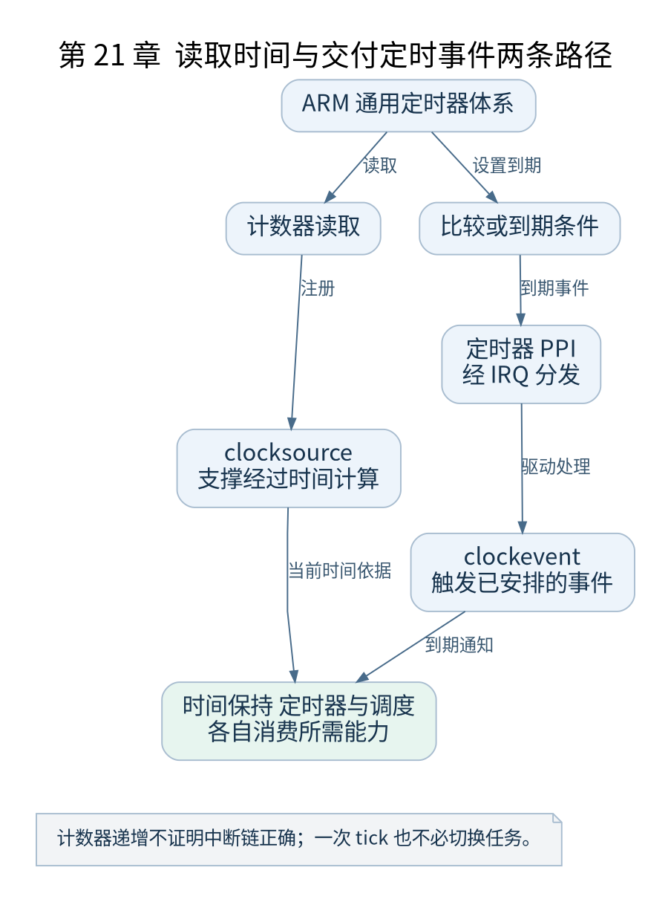

# 第 21 章 时间子系统与通用定时器

[返回全书目录](../README.md)

“现在是什么时间”和“在某个时刻提醒我”是不同问题。Linux 用 clocksource 与 clockevent 等机制分别表达读取时间和产生定时事件，再把它们接到通用时间管理。



**图 21-1　读取时间与交付定时事件两条路径**

读图提示：计数器递增不证明中断链正确；一次 tick 也不必切换任务。 图的箭头表达标注的关系；未标明为调用的箭头，不应当作普通函数调用栈。

### 21.1 通用计数器与比较事件

ARM 通用定时器体系提供计数器及相关定时器寄存器。读取计数值可以估算经过的时间，设置比较或相对到期条件则可产生中断。计数频率不是 CPU 调度频率，不能简单把计数器差值当成纳秒。

计数器可能有不同物理、虚拟访问视图，选择哪一个还受异常级、固件与驱动判断影响。本书分析实际 `arm_arch_timer.c` 分支，不假定所有平台都使用同一种 PPI。

### 21.2 clocksource 与 clockevent

clocksource 提供可读取的递增值及转换所需信息，时间保持层把它接到内核时间模型。clockevent 提供设置下一次事件的能力，供 tick 和高精度定时器等机制使用。

同一硬件体系可以同时承担两种角色，但软件对象和使用路径不同。一个正常递增的计数器，不能证明到期中断一定被正确路由和启用。

### 21.3 启动时如何接入

ARM64 的 `time_init()` 进入定时器探测等路径，设备树声明把兼容节点关联到 `arch_timer_of_init()`。驱动选择适当访问方式、注册中断和每 CPU 资源，完成后通用时间机制才具备对应硬件支持。

需要跨章节看依赖：IRQ 子系统必须能分发相应中断；每 CPU 初始化要和次级 CPU 启动衔接；调度器必须能处理时间驱动的记账和重调度请求。

### 21.4 Tick 不等于每次必切换任务

时钟事件可以触发调度记账、定时器处理和重调度条件判断。但当前任务可能继续运行，也可能因配置和运行状态使用 tickless 策略。不能从时钟中断次数直接推出任务切换次数。

同样，`sleep(1)` 不是让 CPU 忙等一秒。用户程序进入内核请求等待，调度器可以让其他任务运行，到期后再使该任务具备继续运行条件；真正获得 CPU 仍由调度决定。

### 21.5 实验与检查点

使用最小 init 的 `uptime` 命令读取 `/proc/uptime`，并在 BusyBox 阶段观察 `/proc/interrupts`。比较“时间在增加”和“定时器中断在增加”两类证据。若只在 GDB 停止期间观察，虚拟时间推进方式还受 QEMU 执行控制影响。

检查点：clockevent 失效而 clocksource 可读时，为什么轮询时间看似正常，但睡眠唤醒可能出问题？因为读取经过时间和交付到期事件经过不同路径。

### 本章源码阅读入口

- [`arch/arm64/kernel/time.c`](https://github.com/torvalds/linux/blob/v5.10/arch/arm64/kernel/time.c)
- [`drivers/clocksource/arm_arch_timer.c`](https://github.com/torvalds/linux/blob/v5.10/drivers/clocksource/arm_arch_timer.c)

从书包根目录执行以下定位命令，再打开定义或调用点上下文。搜索命中只提供位置，不能替代对配置分支与对象状态的判断。

```sh
rg -n 'time_init|arch_timer_of_init|arch_timer_handler' work/linux/arch/arm64/kernel/time.c work/linux/drivers/clocksource/arm_arch_timer.c
```

