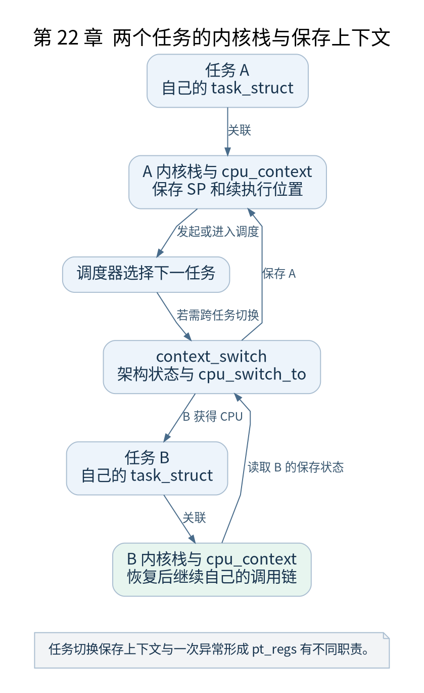

# 第 22 章 调度器初始化与第一个任务

[返回全书目录](../README.md)

CPU 在调度器初始化之前就能执行指令。调度器增加的是管理多个可运行任务、选择下一任务并协调切换的能力。本章从静态初始任务出发理解这项变化。



**图 22-1　两个任务的内核栈与保存上下文**

读图提示：任务切换保存上下文与一次异常形成 pt_regs 有不同职责。 图的箭头表达标注的关系；未标明为调用的箭头，不应当作普通函数调用栈。

### 22.1 init_task 提供初始身份

`init/init_task.c` 定义初始 `task_struct` 及相关对象。它不是运行时调用 fork 后才存在的任务，而是编译链接阶段准备好的基础对象。ARM64 汇编再把当前执行环境与它关联。

任务描述符、任务内核栈和用户地址空间分别描述身份与调度状态、内核执行现场、用户内存映像。纯内核线程通常没有普通用户 `mm`；不能因为它能调度，就假设它拥有一个用户程序地址空间。

### 22.2 sched_init 初始化什么

`sched_init()` 初始化每 CPU 运行队列等调度数据，准备调度类所需基础结构，并安排初始任务状态。多核拓扑与负载平衡等还有后续初始化，不能把一个函数返回当成所有调度功能最终就绪。

运行队列不是简单的“所有进程列表”。任务是否可运行、属于哪个 CPU、使用哪个调度类，都会影响它是否以及如何进入选择范围。

### 22.3 从 schedule 到上下文切换

普通调度路径进入 `__schedule()`，在受保护的状态下处理前一任务并选择下一任务，再经 `context_switch()` 等机制切换。若选择结果仍是当前任务，就不需要进行完整跨任务寄存器切换。

ARM64 的 `__switch_to()` 处理相应架构状态，低层 `cpu_switch_to` 保存和恢复约定的内核执行上下文，包括被调用者保存寄存器、SP 与返回位置。它不是将全部 CPU 硬件状态逐字节复制到任务结构。

### 22.4 为什么切换后像在旧函数返回

每个任务保留自己的内核栈和返回位置。恢复某个任务的上下文后，它可以继续在上次被切走的调用链上返回。源码看起来是一次 `switch_to`，动态观察却是两条执行流在不同时间恢复。

新任务还没有历史调用栈，所以创建路径预先构造一个适当上下文，让第一次恢复时从 `ret_from_fork` 开始。第二十五章会具体解释这项安排。

### 22.5 验证与检查点

在 `rest_init` 附近观察 `current`，再在 `kernel_init` 观察 PID。记录从启动任务到 PID 1 的变化，不要只打印 PC。查看内核栈时要知道当前 SP 属于哪个任务，且使用与配置匹配的展开方式。

检查点：一次函数调用能否改变 `current`？普通调用本身不会；如果调用路径主动调度或被允许抢占，则执行期间可发生任务切换，但返回时仍是原任务继续其调用现场。

### 本章源码阅读入口

- [`init/init_task.c`](https://github.com/torvalds/linux/blob/v5.10/init/init_task.c)
- [`kernel/sched/core.c`](https://github.com/torvalds/linux/blob/v5.10/kernel/sched/core.c)
- [`arch/arm64/kernel/process.c`](https://github.com/torvalds/linux/blob/v5.10/arch/arm64/kernel/process.c)
- [`arch/arm64/kernel/entry.S`](https://github.com/torvalds/linux/blob/v5.10/arch/arm64/kernel/entry.S)

从书包根目录执行以下定位命令，再打开定义或调用点上下文。搜索命中只提供位置，不能替代对配置分支与对象状态的判断。

```sh
rg -n 'init_task|sched_init|context_switch|cpu_switch_to' work/linux/init/init_task.c work/linux/kernel/sched/core.c work/linux/arch/arm64/kernel/process.c work/linux/arch/arm64/kernel/entry.S
```

