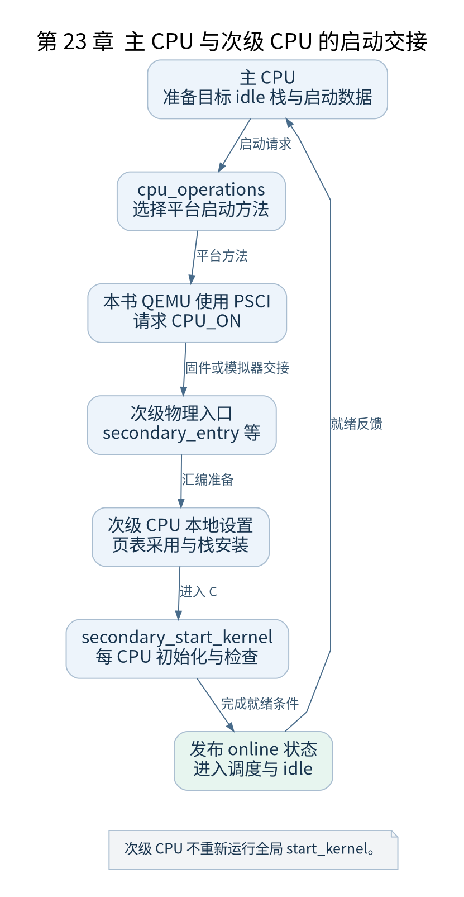

# 第 23 章 启动其他 CPU

[返回全书目录](../README.md)

单核实验帮助理解一条执行流，多核启动则把“一个内核”扩展为多个 CPU 并行运行。每个次级 CPU 都要获得自己的栈和每 CPU 状态，同时共享适当的内核地址空间与全局设施。



**图 23-1　主 CPU 与次级 CPU 的启动交接**

读图提示：次级 CPU 不重新运行全局 start_kernel。 图的箭头表达标注的关系；未标明为调用的箭头，不应当作普通函数调用栈。

### 23.1 发现 CPU 与启动 CPU 是两回事

设备树描述哪些 CPU 存在及它们的启动方法，内核维护 possible、present、online 等集合。possible 表示系统可支持的 CPU 集合，online 表示已经参与运行，二者不能互换。

在本书 QEMU 配置中使用 PSCI 启动方法。其他平台可能采用不同 `cpu_operations` 实现，因此通用 ARM64 SMP 代码通过操作表请求启动，不直接把所有平台写死成同一种固件调用。

### 23.2 主 CPU 准备启动材料

`__cpu_up()` 和 `boot_secondary()` 等路径把次级 CPU 所需状态与 idle 任务关联起来，通过相应操作请求启动，再等待必要的就绪反馈。启动请求成功返回，并不等于次级 CPU 已完成全部初始化。

主 CPU 与次级 CPU 通过共享内存交换启动信息，还需要满足内存可见性要求。仅仅写入栈地址，没有保证次级 CPU 能观察到该值，不能构成可靠交接。

### 23.3 次级入口执行自己的准备

次级 CPU 从约定物理入口进入，经过 `secondary_entry`、`secondary_startup` 等路径完成必要 CPU 设置和 MMU 切换，再进入 `__secondary_switched`，建立对应栈与当前任务，最终到达 `secondary_start_kernel()`。

它不会重复主 CPU 的完整 `start_kernel()`。全局结构已经建立，次级 CPU 需要执行自己的 CPU 本地初始化、能力检查、状态公布和调度衔接。

### 23.4 每 CPU 数据为什么必要

运行队列、IRQ 栈、定时器状态等存在 CPU 本地部分。每 CPU 数据减少共享访问，也表示某些初始化必须在目标 CPU 上执行。把 CPU 0 上一个寄存器写好，不会自动在 CPU 1 上出现相同值。

核间中断可支持重调度、函数调用等协作，但它依赖前面中断控制器和 CPU 接口工作。多核启动因此把中断、内存一致性与调度依赖连接到同一条路径。

### 23.5 实验与检查点

运行 `SMP=4 bash labs/run-qemu.sh`，使用包含 SMP 支持的同一内核观察 CPU online 日志及 `/proc/interrupts` 各列。GDB 的 CPU 线程展示依赖 QEMU，先用 `info threads` 查看，再选择目标 CPU；不要把 GDB 线程编号直接认作 Linux PID。

检查点：次级 CPU 启动失败时，分别检查硬件描述、启动操作、入口地址、共享启动数据、CPU 特性及最终 online 同步点。找到卡住的边界再定位代码。

### 本章源码阅读入口

- [`arch/arm64/kernel/smp.c`](https://github.com/torvalds/linux/blob/v5.10/arch/arm64/kernel/smp.c)
- [`arch/arm64/kernel/head.S`](https://github.com/torvalds/linux/blob/v5.10/arch/arm64/kernel/head.S)
- [`drivers/firmware/psci/psci.c`](https://github.com/torvalds/linux/blob/v5.10/drivers/firmware/psci/psci.c)

从书包根目录执行以下定位命令，再打开定义或调用点上下文。搜索命中只提供位置，不能替代对配置分支与对象状态的判断。

```sh
rg -n '__cpu_up|boot_secondary|secondary_start_kernel|secondary_entry' work/linux/arch/arm64/kernel/smp.c work/linux/arch/arm64/kernel/head.S work/linux/drivers/firmware/psci/psci.c
```

