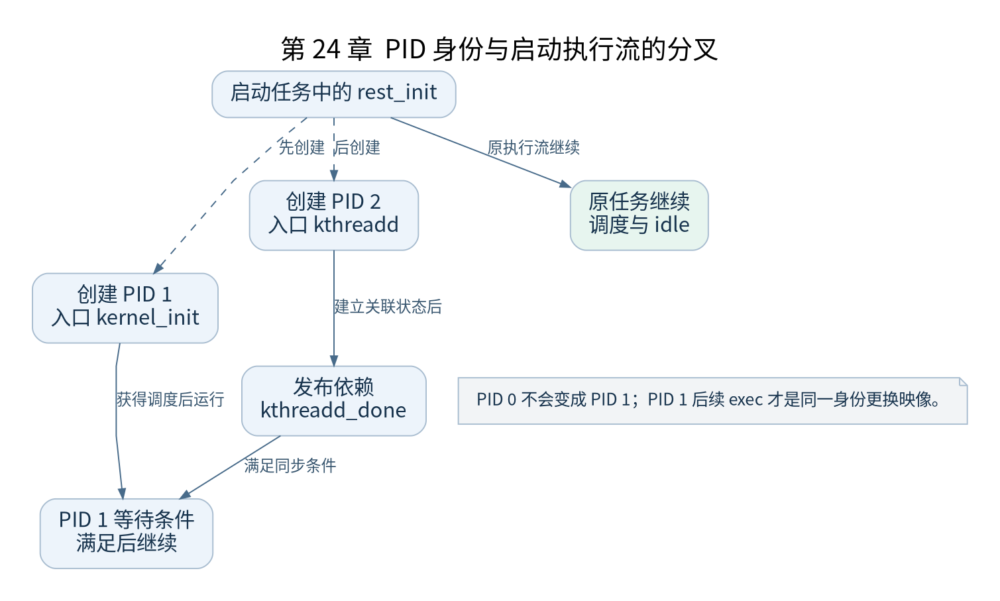

# 第 24 章 rest_init 与 init kthreadd

[返回全书目录](../README.md)

本章是全书的任务身份转折点。之前的主线主要在启动任务中推进；这里创建 PID 1 与 kthreadd，让后续初始化在可调度任务中继续。



**图 24-1　PID 身份与启动执行流的分叉**

读图提示：PID 0 不会变成 PID 1；PID 1 后续 exec 才是同一身份更换映像。 图的箭头表达标注的关系；未标明为调用的箭头，不应当作普通函数调用栈。

### 24.1 先明确调用关系

`start_kernel()` 末尾调用架构钩子 `arch_call_rest_init()`，其默认实现进入 `rest_init()`。正常主线随后不再返回继续执行其他普通启动代码，而由原任务走向调度和 idle 路径。

钩子允许架构组织差异，阅读本书 ARM64 基线时要确认没有覆盖默认实现。不能省略这一层后又声称图完全对应源码调用关系。

### 24.2 为什么先创建 PID 1

内核通过 `kernel_thread()` 建立以 `kernel_init` 为入口的任务，使其获得 PID 1。随后创建 kthreadd，在常见主线中获得 PID 2。前者将完成用户空间启动，后者处理后续内核线程创建需求。

创建顺序保证身份，completion 保证依赖。若只看第一条创建语句而忽略后面的同步，就可能误以为 `kernel_init` 可立即执行所有依赖 kthreadd 的工作。

### 24.3 kthreadd_done 约束哪个时刻

`rest_init()` 建立 `kthreadd_task` 等状态并完成 `kthreadd_done`，PID 1 则在 `kernel_init_freeable()` 开始处等待该条件。若条件尚未满足，它需要等待；若已经满足，等待可以直接通过。

这个条件表示所需启动依赖已发布，不等价于“kthreadd 已经实际执行了多少条指令”。多线程分析必须区分对象创建、状态发布、目标任务执行和消费者越过等待点。

### 24.4 原启动任务去哪里

原任务通过适当调度入口使新任务有机会运行，然后进入 `cpu_startup_entry()` 等 idle 路径。idle 不表示 CPU 从此再也不工作，而是在没有其他合适任务运行时承担空闲循环，并按事件返回调度。

PID 0 不会通过 exec 变成 PID 1。它们在这里已经是不同任务。PID 1 后续 exec 的身份延续，是另一层关系。

### 24.5 验证练习

在 `rest_init`、`kernel_init`、`kthreadd` 和 `cpu_startup_entry` 设置有限次数断点，记录任务名与 PID。预期能看到三个任务的不同身份，但命中次序会受调度和断点影响，不把某次时间顺序当成唯一合法顺序。

检查点：如果 PID 1 在 kthreadd 的创建完成前获得 CPU，会发生什么？沿等待条件解释它在哪里停住，以及哪个执行流让条件满足。

### 本章源码阅读入口

- [`init/main.c`](https://github.com/torvalds/linux/blob/v5.10/init/main.c)
- [`kernel/kthread.c`](https://github.com/torvalds/linux/blob/v5.10/kernel/kthread.c)
- [`kernel/sched/idle.c`](https://github.com/torvalds/linux/blob/v5.10/kernel/sched/idle.c)

从书包根目录执行以下定位命令，再打开定义或调用点上下文。搜索命中只提供位置，不能替代对配置分支与对象状态的判断。

```sh
rg -n 'rest_init|kernel_init|kthreadd|cpu_startup_entry' work/linux/init/main.c work/linux/kernel/kthread.c work/linux/kernel/sched/idle.c
```

