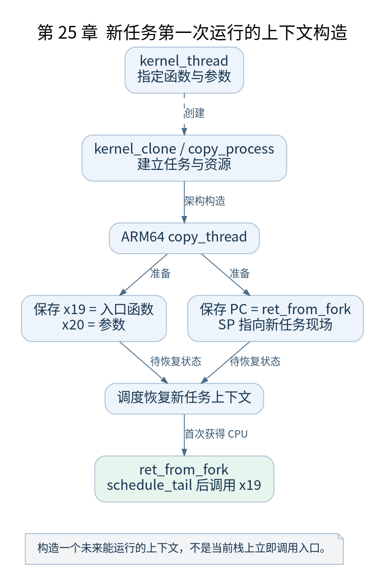

# 第 25 章 内核线程创建与首次运行

[返回全书目录](../README.md)

`kernel_thread(kernel_init, ...)` 没有立即在调用者栈上执行 `kernel_init`。它为一个新任务构造上下文，调度器后来恢复该上下文时，才会进入指定函数。本章追踪这项构造。



**图 25-1　新任务第一次运行的上下文构造**

读图提示：构造一个未来能运行的上下文，不是当前栈上立即调用入口。 图的箭头表达标注的关系；未标明为调用的箭头，不应当作普通函数调用栈。

### 25.1 kernel_clone_args 传递创建意图

v5.10 的 `kernel_thread()` 把入口函数和参数装入 `kernel_clone_args` 的相关字段，并调用 `kernel_clone()`。这里字段名包含 stack，但在这条内核线程路径上承载了特殊约定的函数与参数信息，不能按用户 clone 栈参数机械解释。

`kernel_clone()` 进入 `copy_process()` 等过程，检查标志并创建任务。错误返回值表示创建失败；只有成功完成必要构造后，才能把任务放到可运行路径上。

### 25.2 复制不是把父任务字节原样复用

创建过程分配新的任务对象与栈，按标志复制、共享或重新初始化资源，建立 PID 与关系，并进行安全和资源限制检查。文件表、地址空间与信号相关状态有各自的共享规则。

对内核线程而言，没有按普通用户进程方式复制一个待运行用户程序的 `mm`。本书只沿 PID 1 的创建主线解释必要分支，普通用户 fork 的写时复制不在此章展开。

### 25.3 ARM64 copy_thread 放入启动现场

在 `arch/arm64/kernel/process.c` 中，内核线程分支清理适当的寄存器现场，把入口函数放入将来恢复的 `x19`，参数放入 `x20`，把保存的 PC 指向 `ret_from_fork`，SP 指向新任务所需栈位置。

这解释了一个关键现象：新任务第一次恢复后并不直接从创建者当前源码下一行运行。它的 PC 与栈已经被特意安排到一个能够完成首次运行收尾的位置。

### 25.4 ret_from_fork 怎样调用入口

该汇编入口先完成 `schedule_tail`，再判断是否需要调用内核线程函数。对应路径将参数送入 `x0`，通过 `x19` 指向的函数发起调用。对 PID 1 来说，这里最终执行 `kernel_init`。

后续若成功安装用户程序现场并返回相应路径，代码再走向 `ret_to_user`。普通长期内核线程与 PID 1 的最终去向不同，不能仅凭共用创建机制就认为所有内核线程都会进入 EL0。

### 25.5 验证与检查点

在 `copy_thread` 为 PID 1 构造上下文时，记录保存的 PC、SP、`x19` 与 `x20`，再在 `ret_from_fork` 比较恢复结果。创建初期任务身份信息可能尚未完全附上，条件断点应根据具体阶段选择可靠字段，不要盲目读取未初始化 PID。

检查点：为什么只给 `kernel_init` 建一个普通 C 栈帧不足以创建进程？还缺少任务身份、独立栈、调度状态、资源关系和可恢复上下文。进程创建是一组结构和约定的建立。

### 本章源码阅读入口

- [`kernel/fork.c`](https://github.com/torvalds/linux/blob/v5.10/kernel/fork.c)
- [`arch/arm64/kernel/process.c`](https://github.com/torvalds/linux/blob/v5.10/arch/arm64/kernel/process.c)
- [`arch/arm64/kernel/entry.S`](https://github.com/torvalds/linux/blob/v5.10/arch/arm64/kernel/entry.S)

从书包根目录执行以下定位命令，再打开定义或调用点上下文。搜索命中只提供位置，不能替代对配置分支与对象状态的判断。

```sh
rg -n 'kernel_thread|kernel_clone|copy_process|copy_thread|ret_from_fork' work/linux/kernel/fork.c work/linux/arch/arm64/kernel/process.c work/linux/arch/arm64/kernel/entry.S
```

