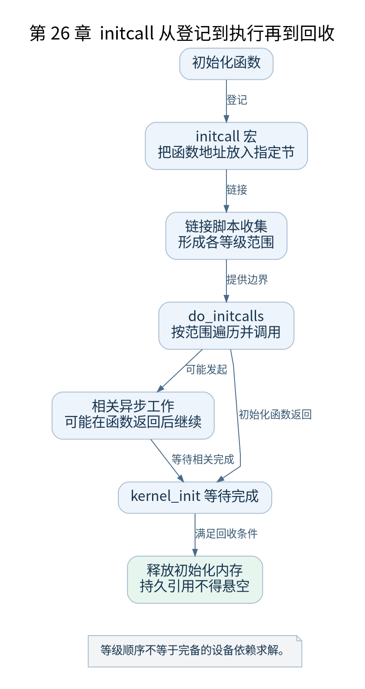

# 第 26 章 kernel_init_freeable 与 initcall

[返回全书目录](../README.md)

PID 1 已经运行，但用户程序还未装入。`kernel_init_freeable()` 让它继续完成可以睡眠、依赖内核线程及多核设施的启动工作，本章特别关注初始化登记与实际执行之间的联系。



**图 26-1　initcall 从登记到执行再到回收**

读图提示：等级顺序不等于完备的设备依赖求解。 图的箭头表达标注的关系；未标明为调用的箭头，不应当作普通函数调用栈。

### 26.1 越过早期限制

函数首先等待 kthreadd 相关条件，随后调整允许的分配行为并继续准备 CPU、workqueue 和其他基础设施。`smp_init()` 与 `sched_init_smp()` 使多核及调度拓扑继续进入相应运行状态。

这一阶段与 `start_kernel()` 中的早期初始化互相衔接，而不是重新初始化所有子系统。比如早期 workqueue 已能管理部分对象，现在才接上所需执行上下文。

### 26.2 宏把函数地址放入节

`include/linux/init.h` 中的 initcall 宏根据等级将函数地址登记到约定节。链接脚本收集相应节并提供边界，启动代码遍历范围调用。读这条机制时要同时打开定义、使用、链接收集和执行四个位置。

常见等级包括 early、pure、core、postcore、arch、subsys、fs、rootfs、device、late 等相关安排。它们在实际链接与执行中有具体组织，不能把字符串排序当成真实等级顺序。

### 26.3 等级不是完备的驱动依赖求解器

同一级内执行顺序可能受链接顺序影响，驱动还可能延迟探测或发起异步工作。因此“某函数先登记”不能证明它的全部外部资源在后续时刻都已就绪。

驱动模型的 `device`、`driver`、`bus` 建立匹配与绑定关系，probe 才真正配置设备。注册驱动、发现设备、匹配成功和 probe 成功是四个可分辨的状态。

### 26.4 初始化内存何时回收

`kernel_init_freeable()` 返回后，`kernel_init()` 等待相关异步初始化完成，再释放初始化内存并进行保护收尾。后续代码若持有指向 `__init` 区域的函数指针，就可能在回收后跳到已复用内存。

因此 initcall 返回成功只说明本次函数结果，并不能自动证明异步资源生命周期正确。使用 `__init` 标注时需要审查所有保存下来的引用。

### 26.5 实验与检查点

本书启动参数包含 `initcall_debug`，用于观察各初始化函数的调用与结果。把一条日志对应到宏登记位置和函数体；返回非零时查看具体错误，不把所有非零结果都解释成致命启动失败。

检查点：若设备树节点存在、驱动函数在镜像中也能查到，但设备仍不可用，应继续检查 initcall 是否执行、设备是否创建、匹配条件和 probe 返回值。这比重复确认“代码编进去了”更接近故障根因。

### 本章源码阅读入口

- [`include/linux/init.h`](https://github.com/torvalds/linux/blob/v5.10/include/linux/init.h)
- [`init/main.c`](https://github.com/torvalds/linux/blob/v5.10/init/main.c)
- [`drivers/base/init.c`](https://github.com/torvalds/linux/blob/v5.10/drivers/base/init.c)
- [`drivers/base/dd.c`](https://github.com/torvalds/linux/blob/v5.10/drivers/base/dd.c)

从书包根目录执行以下定位命令，再打开定义或调用点上下文。搜索命中只提供位置，不能替代对配置分支与对象状态的判断。

```sh
rg -n 'kernel_init_freeable|do_initcalls|do_basic_setup|__define_initcall' work/linux/include/linux/init.h work/linux/init/main.c work/linux/drivers/base/init.c work/linux/drivers/base/dd.c
```

