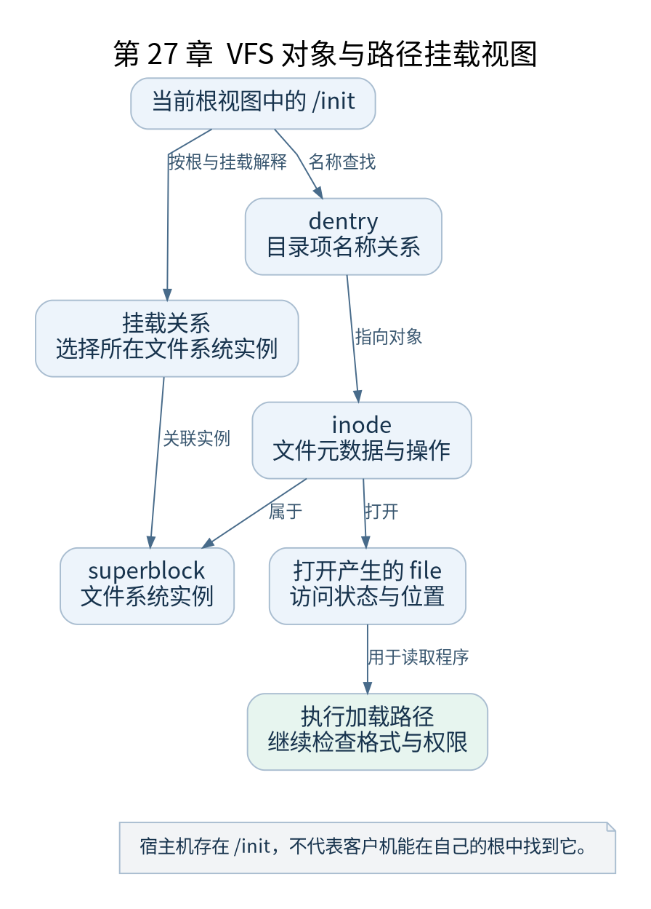

# 第 27 章 VFS 与最初的根文件系统

[返回全书目录](../README.md)

加载用户程序之前，内核必须能解释路径并访问文件。VFS 为不同文件系统提供统一对象和接口，本章只展开启动 init 所必需的部分。



**图 27-1　VFS 对象与路径挂载视图**

读图提示：宿主机存在 /init，不代表客户机能在自己的根中找到它。 图的箭头表达标注的关系；未标明为调用的箭头，不应当作普通函数调用栈。

### 27.1 路径不是磁盘位置

`/init` 是在当前任务的根目录与挂载视图中解释的路径。它可能来自 initramfs 解包后的 rootfs，也可能位于其他挂载文件系统中。看到同一个字符串，不能据此判断对应哪个块设备。

进程根目录、当前目录和挂载命名空间参与路径解释。启动时这些对象由内核逐步建立，普通用户空间以后也能在权限允许的条件下改变自己的视图。

### 27.2 四个常见对象

| 对象 | 表达的核心含义 |
| --- | --- |
| superblock | 一个文件系统实例的整体状态 |
| inode | 文件对象的元数据与操作关联 |
| dentry | 名称与对象之间的目录项关系 |
| file | 一次打开产生的文件状态和操作位置等 |

文件名不是 inode 内唯一且永久的身份。硬链接可以让多个目录项指向同一 inode，文件被打开后，即使名称关系改变，打开的 file 仍有自己的生命周期。

### 27.3 挂载让树连接起来

挂载把一个文件系统实例接到路径树的某个位置。`/proc` 中的内容来自 procfs，`/sys` 来自 sysfs，`/dev` 可以来自 devtmpfs；这些目录名本身不具备自动生成内容的能力，需要合适挂载。

因此初始归档中创建一个空 `/proc` 目录并不等于内核信息已经可读。最小 init 必须执行 mount，且内核必须启用相应文件系统支持。

### 27.4 rootfs 如何先存在

启动 VFS 与挂载初始化会建立初始根，使后续 initramfs 解包有目标。rootfs 的具体实现可受配置影响，常见关联 ramfs 或 tmpfs。不要把它等同于“已经挂载硬盘根分区”。

`fs/namespace.c` 中 `mnt_init()`、`init_mount_tree()` 与 `init/do_mounts.c` 中 `init_rootfs()` 帮助追踪这项建立。随后名称查找、文件打开及执行程序路径才能利用这些对象。

### 27.5 打开文件与执行文件

exec 首先需要找到并打开目标，再校验格式和权限，最后建立程序映像。普通 `open` 成功并不证明该文件可执行，更不证明其 ELF 解释器存在。分析启动错误要把 VFS 查找与格式加载分开。

验证练习：在最小 init 中先读取 `/proc/uptime`，观察挂载失败与读取失败分别如何报错。用 BusyBox 实验查看 `/proc/mounts`，标出 rootfs、proc、sysfs 和 devtmpfs 的不同来源。

检查点：`/sbin/init` 存在于宿主机，并不能帮助客户机执行它。QEMU 客户机要在自己的根视图中找到程序，宿主机目录不会自动成为客户机根文件系统。

### 本章源码阅读入口

- [`fs/namespace.c`](https://github.com/torvalds/linux/blob/v5.10/fs/namespace.c)
- [`fs/super.c`](https://github.com/torvalds/linux/blob/v5.10/fs/super.c)
- [`fs/namei.c`](https://github.com/torvalds/linux/blob/v5.10/fs/namei.c)
- [`init/do_mounts.c`](https://github.com/torvalds/linux/blob/v5.10/init/do_mounts.c)

从书包根目录执行以下定位命令，再打开定义或调用点上下文。搜索命中只提供位置，不能替代对配置分支与对象状态的判断。

```sh
rg -n 'mnt_init|init_mount_tree|init_rootfs' work/linux/fs/namespace.c work/linux/fs/super.c work/linux/fs/namei.c work/linux/init/do_mounts.c
```

