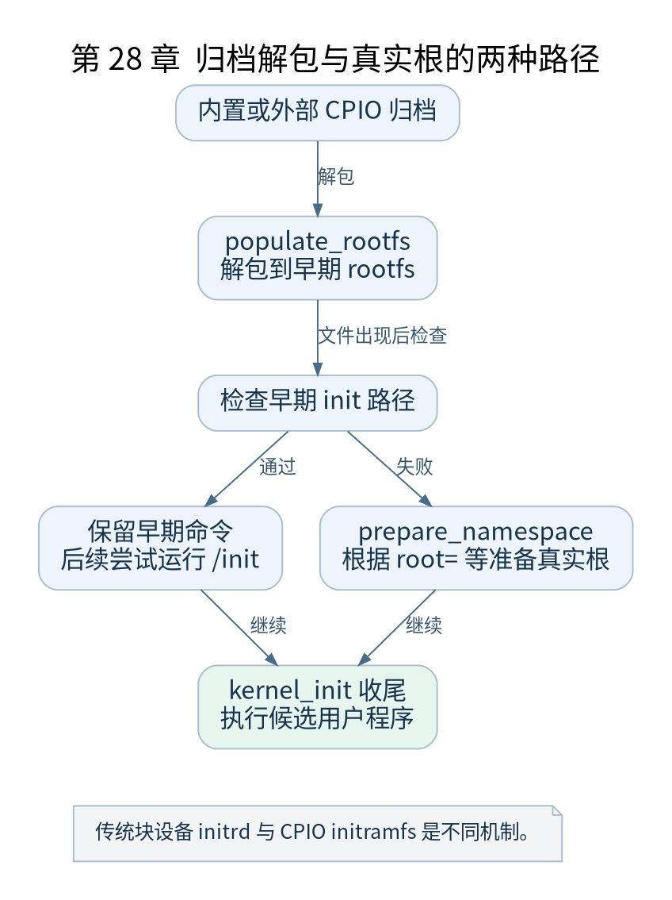

# 第 28 章 initramfs initrd 与真实根文件系统

[返回全书目录](../README.md)

本书的基础实验把一个静态程序放进 CPIO 归档，让内核解包后执行 `/init`。本章解释这个最短路径，并与传统 initrd 和真实块设备根分开。



**图 28-1　归档解包与真实根的两种路径**

读图提示：传统块设备 initrd 与 CPIO initramfs 是不同机制。 图的箭头表达标注的关系；未标明为调用的箭头，不应当作普通函数调用栈。

### 28.1 initramfs 是文件归档

initramfs 通常使用 newc CPIO 格式，可再压缩。内核把归档内容解包到早期根文件系统，不需要先把它当作一个 ext4 磁盘挂载。文件类型、权限、路径和特殊节点等由归档条目表达。

内置归档被链接到镜像相关区域，外部归档则由启动环境提供并通过参数告知。二者进入解包过程的来源不同，实验中外部 `-initrd` 参数提供的文件仍可以是 initramfs 格式，而不必是传统 initrd 镜像。

### 28.2 populate_rootfs 何时执行

`init/initramfs.c` 中的 `populate_rootfs()` 通过 `rootfs_initcall` 登记，使用相应解包逻辑填充 rootfs。此时需要前面建立的 VFS 和根结构，也需要归档数据所在内存仍有效。

解包完成后还可能释放适当的归档占用区域，但解包出来的文件有自己的存储生命周期。不能把释放原始压缩归档等同于删除 `/init`。

### 28.3 检查早期用户程序

`kernel_init_freeable()` 对 `ramdisk_execute_command` 做可访问性检查，默认路径为 `/init`，可由 `rdinit=` 更改。失败时清除该命令并进入 `prepare_namespace()` 等路径，准备真实根。

检查通过仅决定保留早期命令和跳过相应根准备分支；最终执行仍在后续 `kernel_init()` 中尝试。若格式或解释器错误，可能继续进入其他候选处理，所以故障日志需结合实际分支解释。

### 28.4 传统 initrd 与真实根

传统 initrd 通常表示可作为内存块设备使用的文件系统镜像，和直接解包 CPIO 不是同一种机制。v5.10 代码仍处理相关兼容路径，不能只根据参数名含 initrd 就断言走哪一种。

`prepare_namespace()` 根据 `root=` 等条件等待设备、确定根设备并尝试挂载相应文件系统。需要的块驱动和文件系统驱动必须可用；若它们只有模块版本而又没有能加载模块的早期用户空间，就会形成启动依赖缺口。

### 28.5 用户空间切换根

复杂系统常由早期 `/init` 发现设备、解锁或组合存储，再切换到真实根并 exec 后续 init。切换挂载视图与更换程序映像分别由不同机制实现。对 rootfs 的处理还受其特殊性质影响，不应随意用一个 `pivot_root` 命令概括所有实现。

实验用附带脚本列出 CPIO 内容，确认 `/init` 的相对路径、文件模式和 ELF 架构。去掉归档或修改 `rdinit=` 属于故障注入；先保留可启动副本，再观察它落入哪个失败阶段。

检查点：initramfs 的 `/init` 能运行但真实根不能挂载时，内核的 ELF 加载能力已经得到哪一部分验证？应把后续问题转到存储驱动、设备识别和文件系统准备，而不是重查 Image 入口。

### 本章源码阅读入口

- [`init/initramfs.c`](https://github.com/torvalds/linux/blob/v5.10/init/initramfs.c)
- [`init/do_mounts.c`](https://github.com/torvalds/linux/blob/v5.10/init/do_mounts.c)
- [`init/main.c`](https://github.com/torvalds/linux/blob/v5.10/init/main.c)

从书包根目录执行以下定位命令，再打开定义或调用点上下文。搜索命中只提供位置，不能替代对配置分支与对象状态的判断。

```sh
rg -n 'populate_rootfs|prepare_namespace|ramdisk_execute_command' work/linux/init/initramfs.c work/linux/init/do_mounts.c work/linux/init/main.c
```

