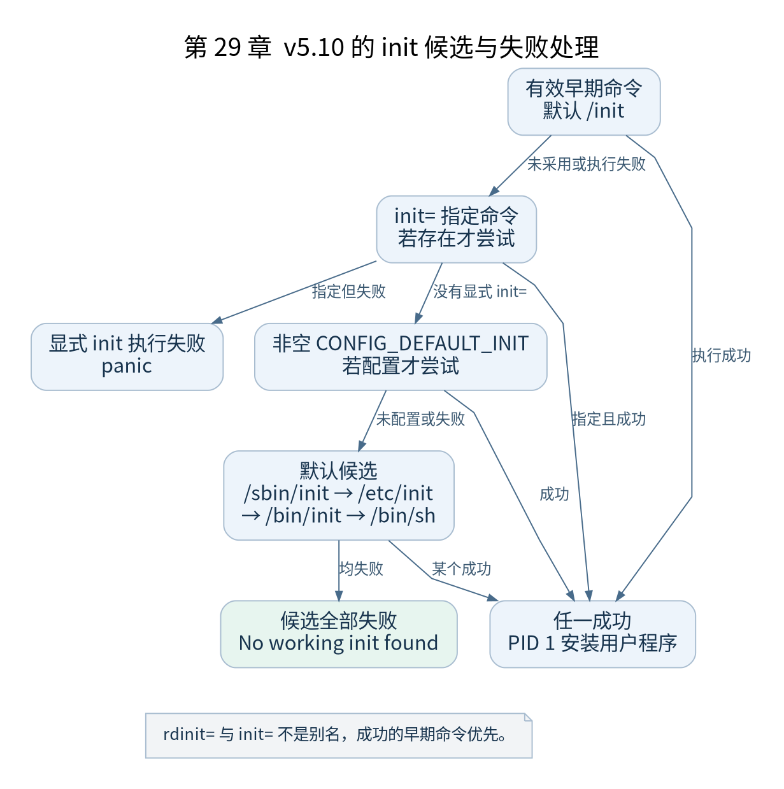

# 第 29 章 PID 1 执行用户程序

[返回全书目录](../README.md)

完成内核阶段初始化后，PID 1 必须选择一个用户程序。这里最容易出现“Linux 固定执行某个路径”的误解。本章按 v5.10 的真实优先级与失败处理分析。



**图 29-1　v5.10 的 init 候选与失败处理**

读图提示：rdinit= 与 init= 不是别名，成功的早期命令优先。 图的箭头表达标注的关系；未标明为调用的箭头，不应当作普通函数调用栈。

### 29.1 先完成收尾

`kernel_init()` 等待相应异步初始化结束，处理初始化内存回收与保护，更新运行状态并完成相关收尾，再进入程序选择。这些操作依然由 PID 1 在内核执行阶段完成。

启动状态进入 `SYSTEM_RUNNING` 与 CPU 已经执行用户指令并非同一时刻。前者是内核状态变量，后者还依赖 exec 加载和架构返回路径。

### 29.2 候选顺序与失败行为

| 次序 | 来源 | v5.10 的重要行为 |
| --- | --- | --- |
| 1 | 仍有效的早期命令，默认 `/init` | 执行失败记录错误后继续后续处理 |
| 2 | `init=` 指定命令 | 若尝试失败则 panic |
| 3 | 非空 `CONFIG_DEFAULT_INIT` | 失败记录错误并继续候选 |
| 4 | `/sbin/init`、`/etc/init`、`/bin/init`、`/bin/sh` | 依次尝试，全部失败后 panic |

`rdinit=` 与 `init=` 对应不同变量，不是简单别名。有早期 `/init` 成功时，显式 `init=` 不会抢在它之前执行。调试用户空间时首先明确你修改的是哪一个入口。

### 29.3 run_init_process 的边界

该函数安排参数并调用 `kernel_execve()`。与用户态 `execve` 系统调用不同，这里文件名和参数来自内核内存，因此使用相应内核参数复制路径。

在 v5.10 中，`kernel_execve()` 通过 `alloc_bprm()` 等建立 `linux_binprm`，统计与复制参数、环境，然后经 `bprm_execve()`、`exec_binprm()` 和二进制处理器查找进入具体格式加载。不要把某旧版本的内部函数签名直接套到此处。

### 29.4 成功 exec 改变什么

exec 安装新的用户程序映像、用户地址空间与初始寄存器现场，同时处理文件描述符关闭标记、凭据和相关进程状态。PID 继续为 1，不能将这一操作描述为产生一个 PID 不同的子任务。

失败也有阶段差异。某些错误可以返回调用者继续尝试候选；进入不可逆的新程序安装阶段后的失败，不能假定总能恢复旧执行环境并像普通函数一样重试。具体处理需沿加载器错误路径分析。

### 29.5 读懂错误码

`ENOENT` 可能指目标路径不存在，也可能指 ELF 解释器不存在；`ENOEXEC` 常与无法识别的格式或架构不匹配有关；`EACCES` 需要核对权限、挂载和安全检查。不要把一条“文件存在”证据当成排除所有执行错误。

验证练习：对 `/init` 运行 `file`、`readelf -h` 与 `readelf -l`。在断点里记录 `run_init_process` 的候选路径与返回值，再和串口日志对应。检查点：解释为什么本书优先使用静态链接程序减少初次启动的不确定因素。

### 本章源码阅读入口

- [`init/main.c`](https://github.com/torvalds/linux/blob/v5.10/init/main.c)
- [`fs/exec.c`](https://github.com/torvalds/linux/blob/v5.10/fs/exec.c)

从书包根目录执行以下定位命令，再打开定义或调用点上下文。搜索命中只提供位置，不能替代对配置分支与对象状态的判断。

```sh
rg -n 'run_init_process|kernel_execve|bprm_execve|exec_binprm' work/linux/init/main.c work/linux/fs/exec.c
```

