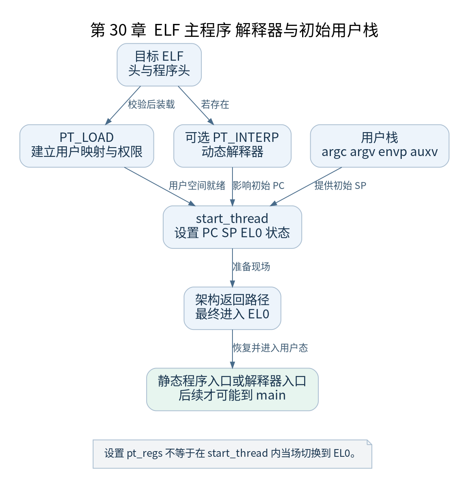

# 第 30 章 ELF 加载与第一次进入 EL0

[返回全书目录](../README.md)

找到文件之后，内核还要把它变成一个可执行的用户环境。本章以 64 位静态 ELF 为主线，解释程序头、虚拟内存区域、用户栈和异常返回之间的连接。



**图 30-1　ELF 主程序 解释器与初始用户栈**

读图提示：设置 pt_regs 不等于在 start_thread 内当场切换到 EL0。 图的箭头表达标注的关系；未标明为调用的箭头，不应当作普通函数调用栈。

### 30.1 装载器主要看程序头

ELF header 提供文件类别、架构、入口和程序头位置等信息。`PT_LOAD` 描述需要映射的段，`PT_INTERP` 描述动态解释器路径。调试用 section 表与装载用 program header 不同，去掉部分调试节不等于程序就不能执行。

段的文件大小与内存大小可能不同，超出文件内容而需要零填充的部分是运行时数据语义的一部分。加载器还要检查对齐、范围、权限和格式，不能仅把文件字节从头复制到某地址就跳转。

### 30.2 静态与动态的第一条用户指令

静态可执行程序通常从其 ELF 入口开始。含解释器的程序则可能先进入解释器入口，由动态链接器完成后续装载与重定位，再转到主程序入口。`AT_ENTRY` 等辅助向量帮助用户运行时了解主程序信息。

因此“第一个用户态 PC 等于主程序 main 地址”在两种情况下都不准确。main 是运行库约定下的 C 层入口；内核安排的是 ELF 和解释器规则所要求的初始位置。

### 30.3 地址空间如何建立

`load_elf_binary()` 检查文件并调用通用 exec 设施，建立或采用新的 `mm`，安排加载段、堆起点和栈等区域。映射建立并不一定立刻将每个文件页全部读入 RAM，后续访问可以通过缺页路径完成。

页表、VMA 和文件映射是不同层的数据表达。VMA 描述一段虚拟范围的规则，页表表达当前具体转换，文件提供内容来源。分析某个用户地址时要把三者连接起来。

### 30.4 初始用户栈放什么

`create_elf_tables()` 等路径准备参数、环境和辅助向量。概念上包括 argc、argv 指针数组及终止项、envp 指针数组及终止项、auxv 条目，以及它们指向的字符串和其他数据。实际地址与对齐由架构、随机化和配置决定。

用户运行库从约定栈布局获得这些信息，再安排语言层调用。把 `argv` 字符串只复制到栈中，却没有正确指针数组和对齐，不是完整的程序启动环境。

### 30.5 start_thread 准备现场

ARM64 的 `start_thread()` 处理用户 PC、SP 和 `PSR_MODE_EL0t` 等状态。它本身不在调用现场直接切到 EL0，而是设置稍后由架构返回路径恢复的寄存器现场。

PID 1 的内核入口路径最终连接到 `ret_to_user` 和相关退出序列，恢复用户现场并通过异常返回进入 EL0。这个边界解释了为什么 exec 可以先在 C 层报告成功，随后才真正执行第一条用户指令。

### 30.6 验证练习

在 `load_elf_binary` 和架构退出附近观察。`start_thread` 是内联函数，GDB 未必能按函数名独立断住，可在 `load_elf_binary` 调用点对应源码行或其后的指令断点检查 `pt_regs`。记录用户 PC、SP 与 ELF 头入口，并说明它们是否受解释器影响。

检查点：一个程序的入口正确但栈无效，为什么仍可能第一条指令就失败？入口代码会立即按调用约定访问栈，合法 PC 并不保证完整用户环境成立。

### 本章源码阅读入口

- [`fs/binfmt_elf.c`](https://github.com/torvalds/linux/blob/v5.10/fs/binfmt_elf.c)
- [`arch/arm64/include/asm/processor.h`](https://github.com/torvalds/linux/blob/v5.10/arch/arm64/include/asm/processor.h)
- [`arch/arm64/kernel/entry.S`](https://github.com/torvalds/linux/blob/v5.10/arch/arm64/kernel/entry.S)

从书包根目录执行以下定位命令，再打开定义或调用点上下文。搜索命中只提供位置，不能替代对配置分支与对象状态的判断。

```sh
rg -n 'load_elf_binary|create_elf_tables|start_thread|ret_to_user' work/linux/fs/binfmt_elf.c work/linux/arch/arm64/include/asm/processor.h work/linux/arch/arm64/kernel/entry.S
```

