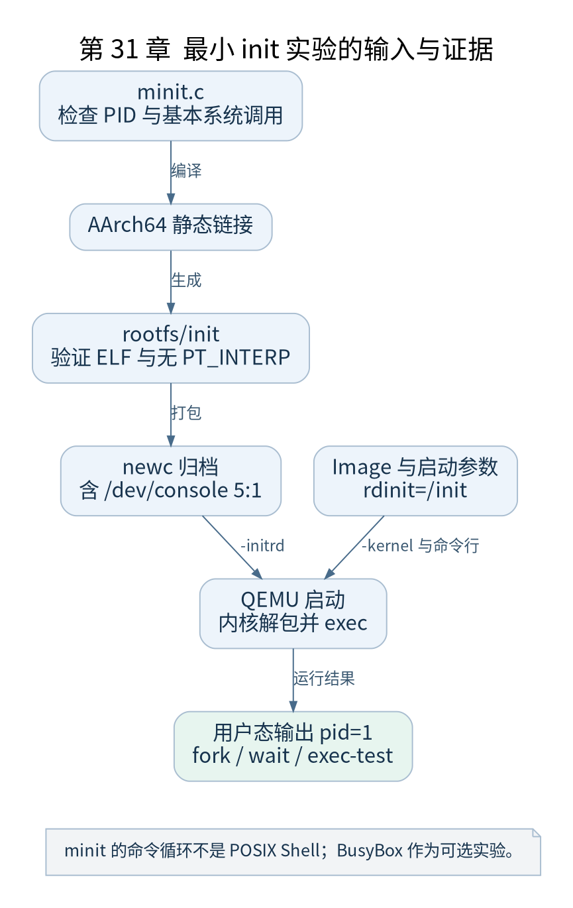

# 第 31 章 编写最小 init 并启动 Shell

[返回全书目录](../README.md)

本章提供真正的用户程序作为全书实验终点。先用自带最小 init 验证 PID 1 与基本系统调用，再用可选 BusyBox 环境获得标准 Shell。两项实验的依赖不同，输出也必须区分。



**图 31-1　最小 init 实验的输入与证据**

读图提示：minit 的命令循环不是 POSIX Shell；BusyBox 作为可选实验。 图的箭头表达标注的关系；未标明为调用的箭头，不应当作普通函数调用栈。

### 31.1 最小程序承担的职责

`labs/minit.c` 建立必要目录，尝试挂载 procfs、sysfs 和 devtmpfs，打开控制台，打印自己的 PID，并提供简单命令循环。它通过 fork、wait 和读取内核信息验证用户空间与内核服务的连接。

代码检查返回值，挂载失败会报告，而不是打印一条无条件“成功”。遇到 EOF 时也不会退出 PID 1，而是保持等待及回收逻辑。PID 1 退出可能使内核进入终止性错误处理，因此它不是可以随意 return 的一次性演示程序。

### 31.2 静态链接减少外部依赖

```sh
mkdir -p work/rootfs-minit
aarch64-linux-gnu-gcc -static -O2 -Wall -Wextra \
  -o work/rootfs-minit/init labs/minit.c
aarch64-linux-gnu-readelf -h work/rootfs-minit/init
aarch64-linux-gnu-readelf -l work/rootfs-minit/init
```

确认 ELF 为 AArch64，且该实验产物没有需要额外提供动态加载器的 `PT_INTERP`。静态链接不表示程序绕开内核，也不保证任意跨版本 ABI 都可用；它只是把这里用到的用户运行库依赖合入可执行文件。

### 31.3 CPIO 构建与控制台

`build-initramfs.sh` 调用随包 `mkinitramfs.py` 生成 newc 归档，并写入 `/dev/console` 特殊节点条目。脚本直接编码归档元数据，不要求主机以 root 执行 `mknod`。控制台设备节点常用主次设备号是 5:1，与设备树中 UART 寄存器地址不是同一编号体系。

内核在用户程序运行前就可能尝试打开 `/dev/console` 作为标准输入输出，因此仅在 init 开始以后再创建设备节点可能太晚。自带归档先提供节点，程序再按需要挂载 devtmpfs 并重新打开控制台。

### 31.4 观察可验证结果

程序预期输出 `pid=1`。输入 `help` 查看命令，`uptime` 和 `interrupts` 读取 procfs，`fork` 创建子进程并由 PID 1 回收，`exec-test` 让子进程 exec 同一个静态文件的另一模式，以验证 PID 延续。

这里的命令循环不是 POSIX Shell，不支持管道、重定向和一般外部命令搜索。它刻意只提供观察启动链所需功能，避免把一个简化解释器宣传成 BusyBox 或 bash。

### 31.5 可选 BusyBox Shell

准备适用于 AArch64 的静态 BusyBox 后，运行 `BUSYBOX=/绝对路径/busybox bash labs/build-initramfs.sh --busybox`。脚本在独立 rootfs 中安装 applet 链接，放入挂载、子进程回收和 Shell 管理脚本。不要把宿主机 x86_64 BusyBox 复制进去。

BusyBox 的构建配置必须包含所需 applet，尤其是 sh、mount、mkdir、setsid、cttyhack 和 sleep 等脚本实际使用命令。附带脚本会验证架构，但不能替代对所有 applet 的功能核对。若程序依赖动态解释器，还需完整提供对应环境。

### 31.6 检查点

保存一次完整启动日志，明确标出内核版本、用户 PID 1 输出、子进程创建与回收。用 GDB 或程序输出分别证明任务身份与用户态执行；不能用一张 Shell 提示符截图推断已经理解中间所有步骤。

### 本章源码阅读入口

- [`init/main.c`](https://github.com/torvalds/linux/blob/v5.10/init/main.c)
- [`fs/binfmt_elf.c`](https://github.com/torvalds/linux/blob/v5.10/fs/binfmt_elf.c)
- [`Documentation/admin-guide/init.rst`](https://github.com/torvalds/linux/blob/v5.10/Documentation/admin-guide/init.rst)

从书包根目录执行以下定位命令，再打开定义或调用点上下文。搜索命中只提供位置，不能替代对配置分支与对象状态的判断。

```sh
rg -n 'run_init_process|load_elf_binary' work/linux/init/main.c work/linux/fs/binfmt_elf.c work/linux/Documentation/admin-guide/init.rst
```

