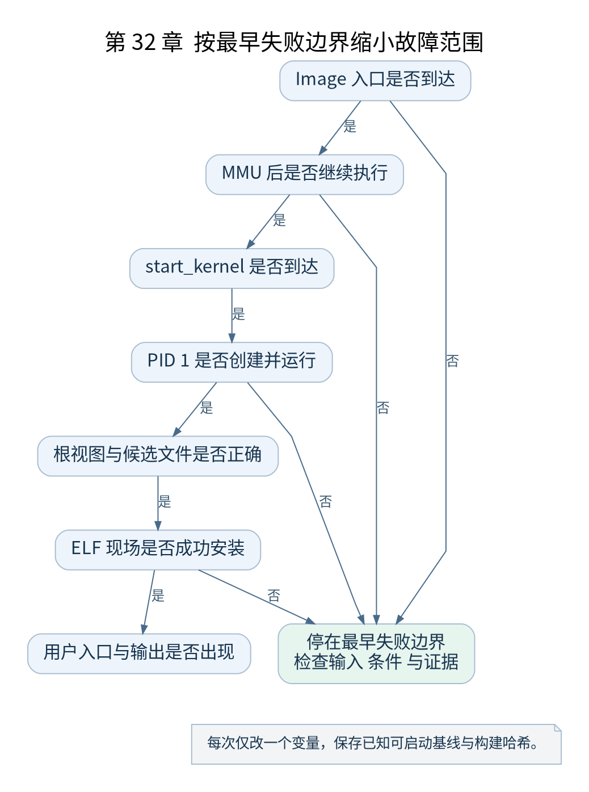

# 第 32 章 完整启动链与故障定位

[返回全书目录](../README.md)

全书最后重新串起启动过程。本章不再增加新机制，而是把已有源码、状态和实验组织成可重复核对的证据链，使读者能够独立定位下一次启动故障。



**图 32-1　按最早失败边界缩小故障范围**

读图提示：每次仅改一个变量，保存已知可启动基线与构建哈希。 图的箭头表达标注的关系；未标明为调用的箭头，不应当作普通函数调用栈。

### 32.1 用状态表代替函数名背诵

| 边界 | 应确认的状态 | 常见证据 |
| --- | --- | --- |
| 进入 Image | 参数、入口 EL、物理位置 | 入口断点与寄存器 |
| 启用 MMU | 表基址、规则、过渡映射 | 描述符与控制寄存器 |
| 进入 start_kernel | 栈、BSS、当前任务关联 | 符号断点与内存 |
| 到达 rest_init | 基础设施与任务创建 | 创建路径和 PID |
| PID 1 内核阶段 | kthreadd 条件、initcall、根视图 | completion、日志、路径 |
| exec 加载 | ELF、解释器、mm、用户栈 | 加载器现场 |
| 进入 EL0 | PC、SP、状态及任务身份 | 返回现场与程序输出 |

表中每行都是一个边界，上一行成功并不保证下一行已经成立。例如启动日志正常而 `/init` 无法执行，问题通常已经跨过入口和基本内存初始化，不应从第一条汇编指令重新猜测。

### 32.2 按最早失败边界排查

无日志时确认 QEMU 进程与串口、Image 加载及入口 PC；卡在 MMU 附近检查映射与 CPU 特性；到达 `rest_init` 后无 PID 1 进展，检查创建与等待；用户程序错误则进入路径、权限、格式和解释器分析。

每次修改只改变一个条件，并保存原始可启动配置。把 Image、vmlinux、配置与归档分别计算哈希，能排除“调试的是上一轮镜像”这类浪费时间的问题。

### 32.3 故障注入的设计

将 `rdinit=` 改为不存在路径，观察早期程序检查如何改变分支；使用无效 ELF 文件观察格式错误；对动态程序漏放解释器观察文件存在却返回找不到文件的情形。所有实验在复制的归档与单独启动命令中进行，不覆盖唯一基线。

真实根挂载失败的实验只应修改客户机虚拟盘与启动参数，不需要操作宿主机真实系统分区。故障实验的价值在于把错误对应到具体层，不是制造不可控破坏。

### 32.4 加回 SMP 与 KASLR

SMP 增加多条 CPU 执行流及同步关系，KASLR 改变地址布局及调试定位。每增加一个变量，更新相应状态记录。SMP 日志先后交错属于可能结果，不能把串口行顺序直接当成严格 happens-before 证明。

启用 KASLR 后，直接使用旧符号地址的断点可能失效。要计算本次偏移或使用适配该环境的调试加载方法；不要把断点失效误解为函数没有运行。

### 32.5 从启动走向其他主题

继续研究内存时，可从页表、缺页和分配路径展开；研究调度时，从任务状态与运行队列展开；研究驱动时，从设备树、irq domain 和 probe 展开；研究安全机制时，把权限与生命周期放回对应启动阶段。

如果继续学习 Android，可以把本书终点连接到 Android 用户态 init，再研究服务管理、Zygote、System Server 与应用安装启动。Android init 的政策与流程属于用户空间实现，不应该倒写成 Linux 内核固定职责。

### 32.6 最终验收

不看书画出从入口到 EL0 的图，标注每条箭头是控制转移、调用、任务创建、调度还是 exec。为每个节点写出当前任务、地址状态和新增能力。再任选五个节点，在源码与一次真实实验中各找到证据。

全书的完成标准，是能解释一个具体镜像为什么按这条路径启动，并能在失败时找到最早未满足的条件。源码中的名字提供入口，状态变化与验证结果才构成理解。

### 本章源码阅读入口

- [`arch/arm64/kernel/head.S`](https://github.com/torvalds/linux/blob/v5.10/arch/arm64/kernel/head.S)
- [`init/main.c`](https://github.com/torvalds/linux/blob/v5.10/init/main.c)
- [`fs/exec.c`](https://github.com/torvalds/linux/blob/v5.10/fs/exec.c)

从书包根目录执行以下定位命令，再打开定义或调用点上下文。搜索命中只提供位置，不能替代对配置分支与对象状态的判断。

```sh
rg -n 'primary_entry|start_kernel|kernel_init|kernel_execve' work/linux/arch/arm64/kernel/head.S work/linux/init/main.c work/linux/fs/exec.c
```

